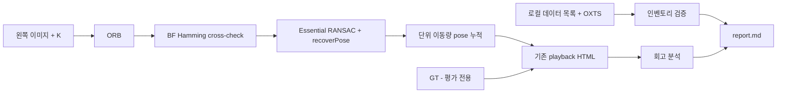

# 회고 분석 아키텍처와 기존 시스템

아래 표는 이번에 실제 실행하는 회고 모듈의 입출력 계약이다. 동일 스크립트에서 순차 실행하고 각 단계 저장/검증 후 다음으로 진행한다.

| 모듈 | 입력 타입/단위/좌표/주기 | 출력 경로 | 처리 / 검증 |
|---|---|---|---|
| provenance | Git 객체, HTML bytes; 배치 1회 | artifacts/provenance/* | 커밋/환경/HTML SHA256 기록, feature 코드 스냅샷 |
| inventory | 폴더/텍스트; OXTS 30 scalars, timestamps ns; 원 센서 좌표 유지 | artifacts/inventory/sequences.json, imu.json, imu_intervals.csv | 파일 개수, IMU 유한값·행/시간 개수 일치; 시간축 이상은 실패를 숨기지 않고 기록 |
| playback parse | embedded JSON; 2D pixels, VO arbitrary units, GT m; 영상 timestamp | artifacts/playback/frames.csv, positions.npz | 200프레임, 단조 영상 시간, 좌표 유한값, mask와 count 일치 |
| analysis | 위 CSV/배열; 같은 프레임 인덱스 | artifacts/analysis/metrics.json, figures/*.png | 궤적 길이·step·inlier 비율; 좌표/스케일 보정 없음 |
| report | 통계/그림/코드/출처 | report.md | 기준 대비 달성/미달/미수행 구분 |

## 기존 VO 계약

- `KittiSequence.read_gray`: uint8 HxW, pixel intensity, rectified left camera, 약 10Hz 영상.
- ORB: keypoint pixel 좌표와 binary descriptor. BF: queryIdx/trainIdx/distance.
- `matched_points`: Nx2 float32, 이전/현재 pixel 좌표.
- `recoverPose`: R 3x3, t 3x1 단위 방향; X_current = R X_previous + t 관례.
- 누적: T_world_current = T_world_previous * inverse(T_current_previous). world는 첫 카메라.
- KITTI 카메라 좌표는 x right/y down/z forward, LiDAR는 x forward/y left/z up.
  현재 파이프라인은 LiDAR/OXTS를 사용하지 않으므로 센서 변환을 실행하지 않는다.
- Raw 절대 timestamp와 Odometry 상대 timestamp의 원점/프레임 대응은 미확정.
  IMU field별 기준축은 oxts/dataformat.txt 및 calibration을 함께 확인해야 하며 묵시적으로 동일시하지 않는다.

## 한계와 통합 제안

기존 baseline은 feature/E/R/t/mask를 파일로 남기지 않는다. exporter는 keypoint/대응/mask/위치만 저장하고 descriptor/E/R/전체 pose는 저장하지 않는다.
이번 분석은 이미 보관된 값만 추출하며 없는 산출물을 복원한 것처럼 주장하지 않는다.
추후 공통 추정 모듈과 frame-index 기반 artifact logger 도입을 제안하되 기존 src 수정은 하지 않는다.
