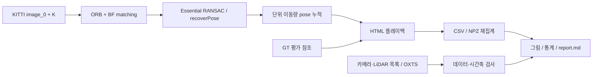
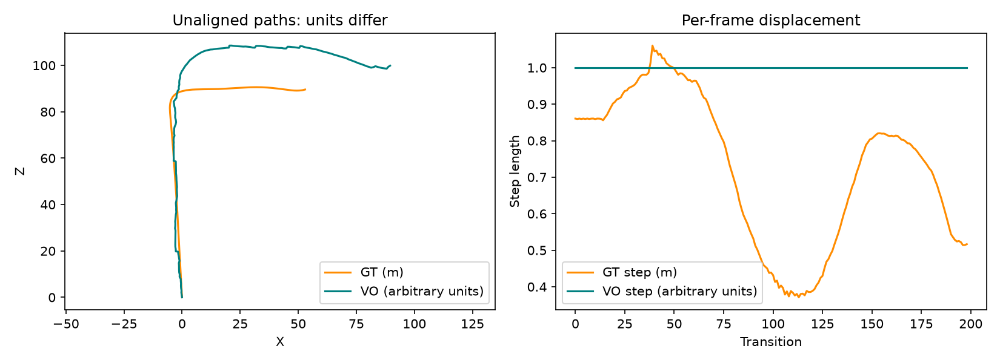
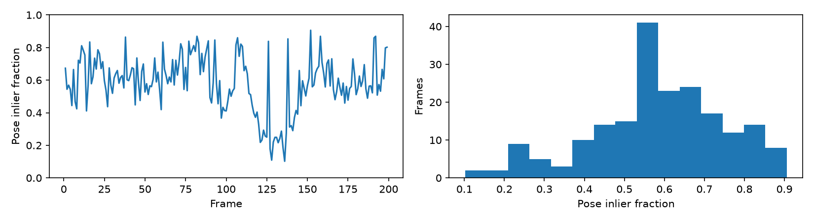
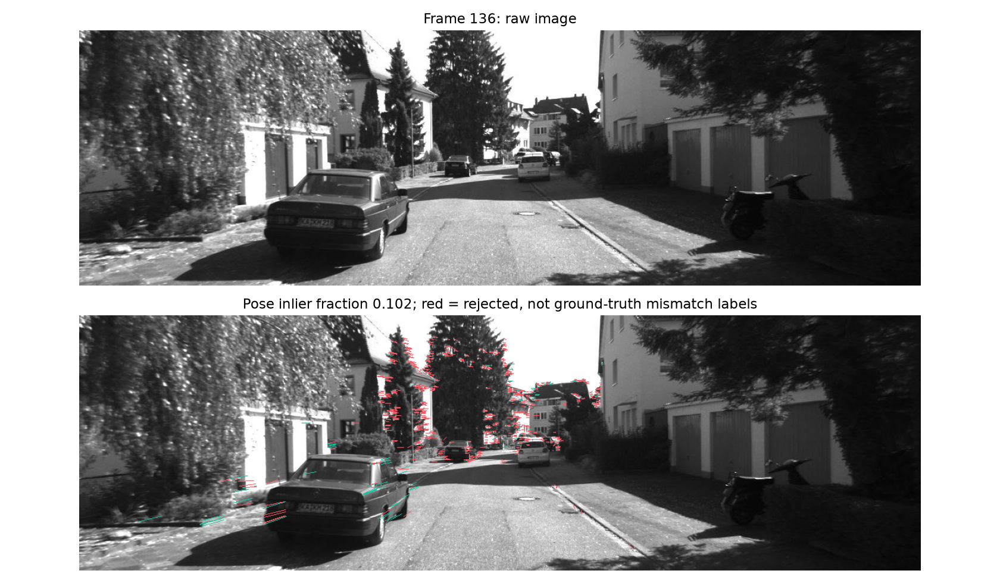
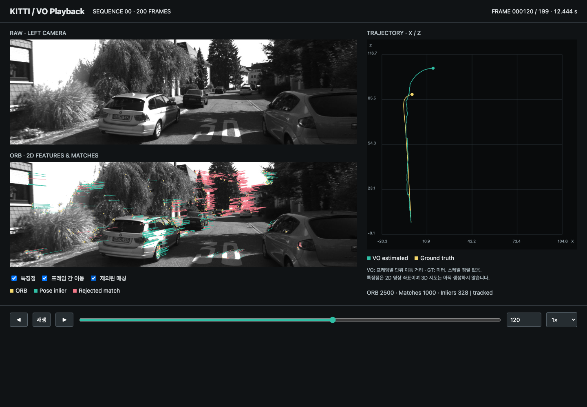
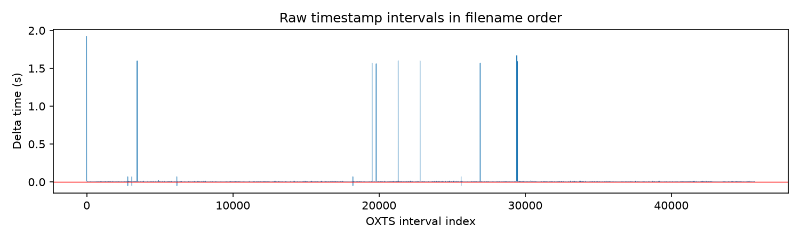

# KITTI VO·디버깅·다중 센서 준비 현황 연구 보고서

작성일: 2026-10-30. 이번 작업은 **기존 작업의 회고 및 보관 결과 재분석**이다. 새 VO/VIO/LIO 알고리즘 개발이나 성능 개선 실험은 수행하지 않았다.

## 1. 요약 (TL;DR)

- ORB 기반 단안 VO와 동기화 HTML 플레이백을 구현했으며, 보관된 KITTI 00의 200프레임을 재분석했다.
- 199개 전이 모두 tracked지만 pose inlier 비율은 10.2~90.6%, 중앙값 58.2%로 변동한다. 이는 정확도 지표가 아니다.
- GT 이동 거리 144.879m와 VO 누적 이동량 199 임의 단위는 직접 오차 비교할 수 없으며, VO는 매 전이 길이 1을 사용한다.
- 카메라·LiDAR 00 각 4,541프레임과 OXTS 45,700개를 확보했다. IMU 시간축에는 비양수 간격 5개와 최대 1.920초 간격이 있다.
- 다음 후보는 Stereo VO 평가 또는 IMU 시간 정렬 연구다. 본 보고서 제출 후 추가 구현·통합은 진행하지 않는다.

## 2. 문제 정의

**문제 진술:** 현재 추정 경로와 GT가 크게 달라 보이지만 스케일과 평가 체계가 정리되지 않아 원인을 정량적으로 분리할 수 없다. 구현·데이터·플레이백의 현황을 증거로 정리하여 다음 연구 선택에 필요한 기준을 만든다.

**Baseline:** 왼쪽 영상으로 ORB → BF Hamming cross-check → Essential RANSAC → recoverPose → 단위 translation 누적을 수행한다. ORB-SLAM이나 metric VO가 아니다. `src/vo/run_kitti.py:28`, `:36`, `:40`, `:42`가 근거다.

**버전 구분:** 현재 `main` HEAD는 `c1b5ff7e3af1525061166953afb6caab855f11c8`이다. 플레이백 및 수정 코드의 feature 커밋은 `365baf354987a3187067bc57fc922eeb1860af9c`이며, 원격 추적 main은 `1a7902fc9acc6cb1121e197ff804f755b137b770`이다. 이번에는 fetch/checkout/merge를 수행하지 않았다. 현재 main에 플레이백 파일과 VSCode 설정이 없는 것은 이 버전 차이에 따른다.

**입력/출력:** 입력은 로컬 KITTI 메타데이터·OXTS와 기존 `outputs/playback.html`이다. 출력은 본 보고서, 모듈별 CSV/JSON/NPZ, 근거 그림이다. 원본 데이터와 기존 알고리즘은 수정하지 않는다.

아래는 이번 회고의 검증 기준이며, 과거 개발 전에 설정된 성능 목표로 소급하지 않는다.

| 성공 기준 | 목표 | 결과 |
|---|---|---|
| 보관 결과 추적 가능성 | 200/200프레임 파싱 및 유한 위치 | 충족 |
| 매칭 집계 정합성 | 전 프레임 mask의 참 개수와 inlier 수 일치 | 충족 |
| 데이터 현황 | 시퀀스별 개수, GT 유무, IMU 시간 통계 저장 | 충족 |
| VIO 입력 시간 순서 | 비양수 간격 0개 | 미달: 5개; 이는 VIO 준비 기준이지 회고 실패가 아님 |
| VO metric accuracy 향상 | baseline 대비 개선 | 미평가: 개선 알고리즘/정렬 평가 실험 없음 |

**제약:** macOS arm64, Python/OpenCV, 기존 결과 00의 앞 200프레임 중심, 과거 latency/회전 history 미보관. 실시간 목표값은 미정이다. [가정] 다음 성능 연구는 동일 구간·평가 조건에서 baseline 대비 개선을 기준으로 시작한다.

**범위 밖:** Stereo VO, BA, 지도 생성, loop closure, VIO/LIO 구현; 기존 모듈 수정; 새 센서 데이터 다운로드; Git 통합/커밋/푸시.

## 3. 사용 가능한 리소스

표는 이번에 확인한 리소스 요약이다. 전체 목록과 코드 위치는 [인벤토리](notes/inventory.md)에 있다.

| 리소스 | 현재 상태 | 제약 |
|---|---|---|
| Stereo grayscale | 00~21, 00 좌우 각 4,541장 | VO는 image_0만 사용 |
| GT | 00~10 pose 파일 | 평가용, 추정 입력으로 사용하지 않음 |
| LiDAR | Odometry 00의 4,541개 XYZI 스캔 | 다른 시퀀스 미추출; 추정 알고리즘 미구현 |
| OXTS | 45,700행 × 30열, 전 값 finite | IMU 외 GPS/INS 항목도 포함; 시간축 이상 존재 |
| Calibration | P0~P3/Tr, Raw 세 calibration 파일 | 센서간 변환 체인 실측 검증 전 |
| 플레이백 | 원본/ORB/매칭/GT·VO 동기화, seek/step/speed | 계산 후 재생; 실시간 VO 처리 성능 아님 |
| Feature | ORB 위치/descriptor, Hamming distance, inlier mask | 3D landmark나 semantic label 아님 |
| 부족한 것 | 공통 평가기, full pose log, stereo/VIO backend | ATE/RPE/latency 결과 아직 없음 |

데이터는 `data/kitti/dataset`, `data/kitti/raw`, 원본 ZIP은 `data/kitti/archives`에 있다. 이전 단계에서 Downloads의 세 ZIP을 이동하고 LiDAR 00과 OXTS·timestamp·calibration만 추출했다. Raw 영상/Raw LiDAR 중복 추출은 하지 않았다. 이 이력은 `data/kitti/SENSOR_IMPORT.md`와 이전 실행 기록에 근거한다.

## 4. 접근 방법 선정

**Quick-win 판단:** inlier mask를 `sum()/255`로 집계하는 오류는 feature 브랜치에서 `count_nonzero`로 수정됐다. 이는 표시/집계 정확성 개선이며 궤적 정확도 개선을 의미하지 않는다. 현재 main의 `src/vo/two_view.py:24`에는 이전 방식이 남아 있다. 이번 회고에서는 수정하지 않는다.

프레임마다 t 길이를 1로 두는 구조는 임계값 조정만으로 실제 거리 문제를 해결할 수 없다. 특징점 알고리즘 교체의 효과는 실험되지 않았으므로 ORB가 성능 저하의 주원인이라고 단정하지 않는다.

다음 표는 제한된 선행연구 조사에 따른 적용성 판단이다. 자세한 저자/연도/가정은 [선행연구 노트](notes/prior_work.md)에 있다.

| 방법 | 필요 입력/보유 여부 | 추가 작업 | 연산량·결합 | 판단 |
|---|---|---|---|---|
| 현재 ORB/BF/E | 영상/K 있음 | 평가 로그 | 실시간성 미측정, 낮은 결합 난이도 | baseline |
| 매칭 gate/grid | 영상/매칭 있음 | 분포와 ablation | [가정] 낮은 비용 | 작은 실험 후보, scale 해결 불가 |
| Stereo triangulation/PnP | 좌우 영상/calibration 있음 | 깊이와 3D-2D 대응 | 실측 전, 중간 난이도 | 다음 우선 후보 |
| ORB-SLAM2 | 영상 있음, 지도/최적화 없음 | keyframe·BA·loop | 실측 전, 높은 난이도 | 구조 학습 참조 |
| VINS-Mono | 영상/IMU 파일 있음 | 시간 정렬·bias/noise·초기화 | 실측 전, 높은 난이도 | 입력 검증 이후 |

선택한 이번 접근은 **보관 산출물 감사**다. 새 알고리즘 후보 선정과 실행은 사용자의 다음 지시로 분리한다.

## 5. 시스템 아키텍처



그림은 기존 VO 경로와 이번 회고 경로를 구분한다. LiDAR/IMU는 아직 pose 추정에 연결되지 않는다.

| 모듈 | 입출력 | 산출물 / 검증 |
|---|---|---|
| Provenance | Git·HTML bytes → 버전/hash | artifacts/provenance/environment.json, 코드 스냅샷 |
| Inventory | 파일 목록·OXTS → 개수/시간 간격 | artifacts/inventory/*.json, imu_intervals.csv |
| Playback parsing | 2D 관측·positions → frame-index 표 | artifacts/playback/frames.csv, positions.npz; count/mask 일치 |
| Analysis | positions/통계 → 길이/비율/그림 | artifacts/analysis/metrics.json, figures/ |

표는 실제 실행한 분석 모듈의 계약 요약이다. 자세한 타입·단위·좌표계·주기와 통합 제안은 [아키텍처 노트](notes/architecture.md)에 있다. 좌표 변환이나 GT 기반 스케일 보정은 이번 분석에서 하지 않았다.

## 6. 실험 설정

- 기존 산출물: KITTI 00, 프레임 0~199, 199개 시간 전이.
- ORB 최대 2,500개, BF Hamming cross-check, 거리순 상위 1,000개, Essential RANSAC prob=0.999/threshold=1 pixel.
- feature exporter는 pose inlier 5개 미만 또는 추정 실패 시 이전 위치 유지; baseline runner와 오류 처리 정책이 다르다.
- 분석 설정: [configs/audit.json](configs/audit.json). 공간 점유는 8×4 격자 기준.
- 현재 분석 환경: Python 3.11.14, OpenCV 5.0.0, NumPy 2.4.6, Matplotlib 3.11.1. 웹 문서 OpenCV 4.13.0과 설치 버전 차이를 유의한다.
- 커밋/환경/원본 HTML SHA256: [environment.json](artifacts/provenance/environment.json).
- HTML 자체에는 생성 커밋과 환경이 기록되지 않았다. feature 커밋과의 대응은 이전 작업 이력에 근거하며 bit-exact 재생성은 미검증이다.

레포 루트에서 이번 재집계와 그림을 재현한다. 기존 outputs/playback.html과 로컬 KITTI 데이터가 필요하다.

```bash
env MPLCONFIGDIR=.cache/matplotlib XDG_CACHE_HOME=.cache \
  .venv/bin/python research/20261030_progress-review/src/audit.py
```

원본 HTML이 없는 새 환경은 feature 커밋을 별도 worktree에 준비하고 다음 명령으로 생성할 수 있다. 이는 이번 실행 명령과 구분된다.

```bash
git worktree add --detach /tmp/visual-slam-review-365baf3 365baf3
cd /tmp/visual-slam-review-365baf3
/Users/youth/Project/visual-slam-lab/.venv/bin/python -m src.viz.export_playback \
  --data-root /Users/youth/Project/visual-slam-lab/data/kitti/dataset \
  --sequence 00 --max-frames 200 \
  --output /Users/youth/Project/visual-slam-lab/outputs/playback.html
```

위 재생성은 기존 HTML을 덮어쓰므로 기존 결과 보존 시 다른 출력 경로를 쓰고 audit.json도 변경해야 한다. 의존성 lock과 난수 seed를 보관하지 않았으므로 완전 동일한 추정 결과 재현은 보장하지 않는다. 이번 연구 스크립트는 아직 커밋되지 않았으며 기존 HEAD만 기록했다.

## 7. 결과

아래 표는 **기존 baseline 보관 결과의 재집계**이며 개선 방법과의 A/B 실험은 아니다.

| 지표 | 기존 결과 재집계 | 개선 알고리즘 |
|---|---:|---|
| 프레임 / 전이 | 200 / 199 | 미구현 |
| tracked 상태 | 199 / 199 전이 | 미평가 |
| ORB 개수 | 모든 프레임 2,500 | 미평가 |
| pose inlier 비율 최소/중앙/최대 | 10.2% / 58.2% / 90.6% | 미평가 |
| GT 누적 이동 거리 | 144.879m | 비교 참조 |
| VO 누적 이동량 | 199 임의 단위 | 미평가 |
| GT 1프레임 이동 | 0.371~1.060m | 비교 참조 |
| VO 1프레임 이동 | 약 1 고정 | 미평가 |
| ATE/RPE/heading error/latency | 미측정 | 미평가 |



그림 1. 스케일 미정렬 궤적과 이동량. 서로 다른 단위이므로 곡선 차이를 미터 오차로 읽으면 안 된다. GT의 이동량 변화에 비해 VO의 길이는 고정된다.



그림 2. 매칭 중 pose 복원 후 살아남은 비율. 정답 대응 label이 없으므로 precision/recall은 아니다.



그림 3. 구간 내 최저 inlier 비율인 frame 136. 빨간 선은 기하/cheirality 검사에서 제외된 대응이며 실제 오매칭임을 보증하지 않는다.



그림 4. 이전에 저장한 데스크톱 UI(frame 120). 원본 영상/특징점/궤적의 동기 관찰이 가능하다. 과거 Playwright 재생·탐색·모바일 검증은 대화 실행 기록에 근거하며 이번에는 브라우저 검증을 다시 실행하지 않았다.



그림 5. OXTS 파일명 순서에서의 timestamp 차이. 중앙값 0.009996736초, 최소 -0.050010872초, 최대 1.919595343초, 비양수 간격 5개다. 원인은 아직 확인하지 않았다.

모듈 검증: 200프레임 파싱/유한 위치/영상 timestamp 단조 증가/inlier mask 일치 통과. IMU 45,700×30 유한값 및 timestamp 개수 일치 통과. **IMU 시간 단조성은 미달**이다. LiDAR 이미지 번호 일치와 첫/끝 XYZI 디코딩은 앞선 import 검증에서 통과했으며 전체 스캔 geometry 품질 검증은 아니다.

## 8. 분석

### 8.1 Feature 강점/약점

| Feature | 강한 조건 또는 관찰 | 약한 조건 또는 한계 | 근거 |
|---|---|---|---|
| ORB 위치 | 이번 구간에서 2,500개를 지속 확보 | 개수가 많아도 분포/독립성/정확성 보장 안 됨 | frames.csv; 32칸 중 최소 13칸 점유 |
| Binary descriptor/Hamming | 실제 실행에서 프레임 대응 생성 | 반복무늬·시점/조명 변화 취약 가능성 [가정] | 코드 및 그림 3; 거리별 GT 분별력 미측정 |
| Pose inlier mask | 기하 일관성에 따른 후보 분리 | 비율 변화 큼, 정확도/정답 label 아님 | 그림 2, 최소 10.2% |
| Stereo disparity | metric 깊이 추출 가능성 | 원거리·작은 disparity 취약 예상 [가정] | P0/P1와 우측 영상 존재; 아직 미추출 |
| LiDAR XYZI | 공간 좌표 관측 가능 | 동적 객체·희소성 영향 [미확인] | 데이터 확보만 완료, 알고리즘 실험 없음 |
| IMU 가속도/각속도 | 약 100Hz 시간 간격의 측정 존재 | 시간 역전/간격 이상, bias/noise 미검증 | imu.json, 그림 5 |

표는 실측 관찰과 가설을 구분한다. Feature ablation, 실제 match label에 따른 분포 분리도, 오차 상관관계는 **미수행**이다. 2D 특징점 시각화를 3D 지도라고 부르지 않는다.

### 8.2 알고리즘의 약점 및 실패 사례

1. **Scale 부재:** 서로 독립적인 두 프레임 추정에서 t 방향만 얻어 길이 1로 누적한다. 이는 단순한 전역 scale 차이뿐 아니라 구간별 속도 변화에 따른 형상 왜곡을 만들 수 있다. 그림 1과 runner:40이 근거다.
2. **낮은 inlier 구간:** frame 136은 1,000개 중 102개만 pose inlier다. 추정 상태는 tracked지만 정답 자세가 맞는지는 별도 평가하지 않았다. 원인을 차량 운동/오매칭/작은 시차 중 하나로 단정하지 않는다.
3. **main의 실패 처리:** 매칭 부족 시 frame을 생략하고 GT를 단순 앞부분 slicing한다(`run_kitti.py:30`, `:51`). 실제 skip이 생기면 frame 대응이 어긋날 수 있다. 이번 보관 구간의 실제 skip 사례는 없다.
4. **추정 구현 중복:** exporter는 자체 E/pose 처리와 최소 inlier gate를 갖고 runner와 동작이 다르다. main의 inlier 집계 오류도 남아 있다. 두 실행 결과를 동일 구현으로 무조건 취급하면 안 된다.
5. **IMU 입력 이상:** 파일 순서와 시간 순서가 일부 다르다. timestamp만 정렬하면 해결되는지, packet 순서/중복/누락 문제인지 확인 필요. 측정값·시각 대응을 깨뜨리는 임의 정렬은 하지 않았다.
6. **다운로더 재개:** feature 코드 `scripts/download_kitti_odometry.py:32` 부근은 Range 응답이 206인지와 Content-Range를 검증하지 않고 append한다. 서버가 Range를 무시하면 손상 가능성이 있다. 이번 다운로드에서 실제 손상이 있었다는 뜻은 아니다.

### 8.3 문제 해결 정도

데이터 확보와 시각 디버깅, 관측 집계까지 완료됐다. metric VO 개선 여부, VIO/LIO 성능은 평가할 단계가 아니다. 00의 약 200프레임 결과만으로 전 시퀀스/고속/야간/동적 객체 성능을 일반화할 수 없다. 목표 성능 수치를 과거에 정하지 않았으므로 임의의 달성률은 제시하지 않는다.

## 9. 개선 방향

아래 표는 구현 지시가 아닌 선택을 위한 제안이다. 효과와 공수는 [가정]이며 벤치마크 결과가 아니다.

| 약점 | 보완 / 필요한 입력 | 기대 효과 | 공수 |
|---|---|---|---|
| 버전·평가 불일치 | 공통 pose 추정기, frame-index/full pose logger, 환경 lock | 비교 재현성과 실패 추적 | 중간 |
| Scale 부재 | Stereo 깊이 + temporal PnP/RANSAC | metric 경로 비교 가능 | 중간 |
| 매칭 품질 | grid 분산, 거리/ratio gate ablation, KLT 비교 | 관측 품질 개선 가능 | 중간 |
| Drift | keyframe/3D map/local BA | 다중 관측 일관성 개선 가능 | 높음 |
| IMU 시간축 | 이상 구간 명세, Raw/Odometry 시간 대응, 축/단위/bias 검증 | VIO 입력 기반 마련 | 중간 |
| LiDAR 미활용 | 카메라 projection 및 시간 대응 검증, 이후 registration baseline | 별도 거리 관측 비교 | 중간~높음 |

기존 시스템 통합 시 camera↔LiDAR↔IMU 변환 방향과 rectification을 명시해야 한다. OXTS의 위치·자세를 estimator에 섞으면 GT 누출이 생길 수 있으므로 IMU 측정 채널과 GPS/INS 참조 채널을 분리해야 한다. MLE/MAP·공분산·재투영 오차는 이후 BA/VIO 설계를 설명하는 학습 주제이며 현재 구현된 backend가 아니다.

## 10. 다음 단계 제안

1. **평가 기준과 baseline 통일:** full pose/frame 상태 로그와 metric/scale-aligned 평가 규칙을 연구 폴더에서 확정한다.
2. **Stereo VO 연구:** 기존 좌우 영상으로 깊이/PnP를 구성하고 동일 구간 baseline 대비 평가한다. 목표값은 Phase 1에서 정한다.
3. **IMU 시간축·센서 정렬 연구:** 비양수 간격 5개와 긴 gap의 원인을 조사하고 동기화 검증 보고서를 만든다.
4. **LiDAR 00 비교 재생 연구:** 카메라에 LiDAR를 투영해 extrinsics/시점을 검증하고 공간 관측을 비교한다.

사용자가 다음 작업을 지정하기 전에는 위 항목을 실행하지 않는다.

## 부록

### 가정 목록

- 다음 성능 연구는 동일 조건의 baseline 대비 개선으로 목표를 시작한다. 구체적 임계값은 아직 없다.
- Stereo/PnP의 metric scale 확보, grid/gate/KLT의 품질 효과와 예상 공수는 설계 판단이며 실험 결과가 아니다.
- 시점/조명 변화나 작은 disparity의 영향은 일반적 가설이며 이 데이터에서 ablation하지 않았다.

### 미확인 사항

- IMU 비단조 시간/긴 gap 원인 및 Raw↔Odometry 정확한 시간 대응.
- IMU noise/bias, field별 적용 축, 동적 객체 GT, LiDAR 전체 스캔 품질.
- ATE/RPE/회전 오차, latency, 메모리, 다른 시퀀스 일반화 성능.
- 기존 HTML 생성의 정확한 환경/난수 상태/커밋 provenance; 이번 hash로 현재 파일만 식별.
- 원본 대용량 ZIP 전체 재검증은 이번 회고에서 하지 않았다.

### 참고문헌

1. [OpenCV ORB 공식 설명](https://docs.opencv.org/4.13.0/d1/d89/tutorial_py_orb.html) — Rublee 외, ORB, 2011의 개념 및 API 배경.
2. [OpenCV Feature Matching](https://docs.opencv.org/4.13.0/dc/dc3/tutorial_py_matcher.html) — Hamming/cross-check 동작.
3. [OpenCV calib3d](https://docs.opencv.org/4.13.0/d9/d0c/group__calib3d.html) — Essential, recoverPose, PnP API.
4. [KITTI Odometry](https://www.cvlibs.net/datasets/kitti/eval_odometry.php) — 시퀀스/GT와 공식 segment 평가 정의. 이번에는 공식 100~800m 평가를 실행하지 않았다.
5. [KITTI Raw](https://www.cvlibs.net/datasets/kitti/raw_data.php) — 센서/보정/동기화 형식.
6. [Mur-Artal, Tardos, ORB-SLAM2](https://arxiv.org/abs/1610.06475), arXiv 2016 / T-RO 2017.
7. [Qin, Li, Shen, VINS-Mono](https://arxiv.org/abs/1708.03852), arXiv 2017 / T-RO 2018.

### 제출 점검

- 회고 기준·baseline 재집계·그림 설명·모듈 산출물·코드 근거·재현 명령: 포함.
- 새 알고리즘 A/B 개선, feature ablation, full pose 정확도 평가: 미수행으로 표시.
- 과거 시스템의 E/R/descriptor 중간 산출물: 미보관 사실을 명시.
- 프로젝트 지침: 루트 CODEX.md에 연구 워크플로우 기록, AGENTS.md에서 참조.
