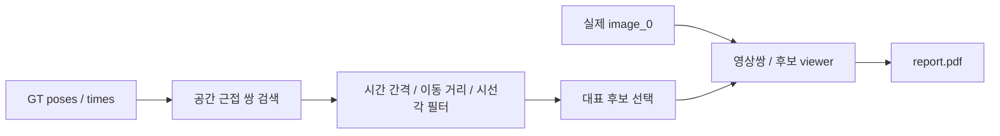

# 단계 계약

| 모듈 | 입력 | 출력 | 검증 |
|---|---|---|---|
| 근접 검색 | Nx3 GT 위치 m, first-camera frame | artifacts/candidates.csv | 순서/시간차/유한 좌표 |
| 후보 필터 | indices, GT rotation, timestamp s | artifacts/summary.json | 설정값 만족, GT oracle임 명시 |
| 이미지 비교 | uint8 left PNG | figures/pair_*.png, artifacts/loops/index.html | 실제 decode, 후보 프레임 번호 표시 |
| 경로 표시 | GT X/Z m 및 후보 | figures/full_trajectory.png | 추정 궤적과 혼동하지 않게 라벨 |

GT는 연구 대상 장면을 고르는 oracle일 뿐 place recognition 입력으로 배포하지 않는다.
기존 VO/LO source 수정 없이 별도 연구 viewer를 생성하고 비교 플레이백에서 링크한다.
