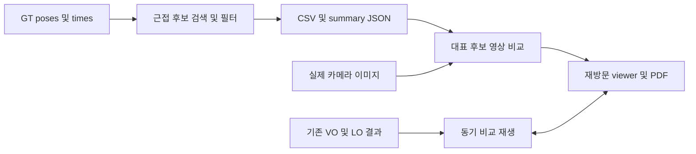
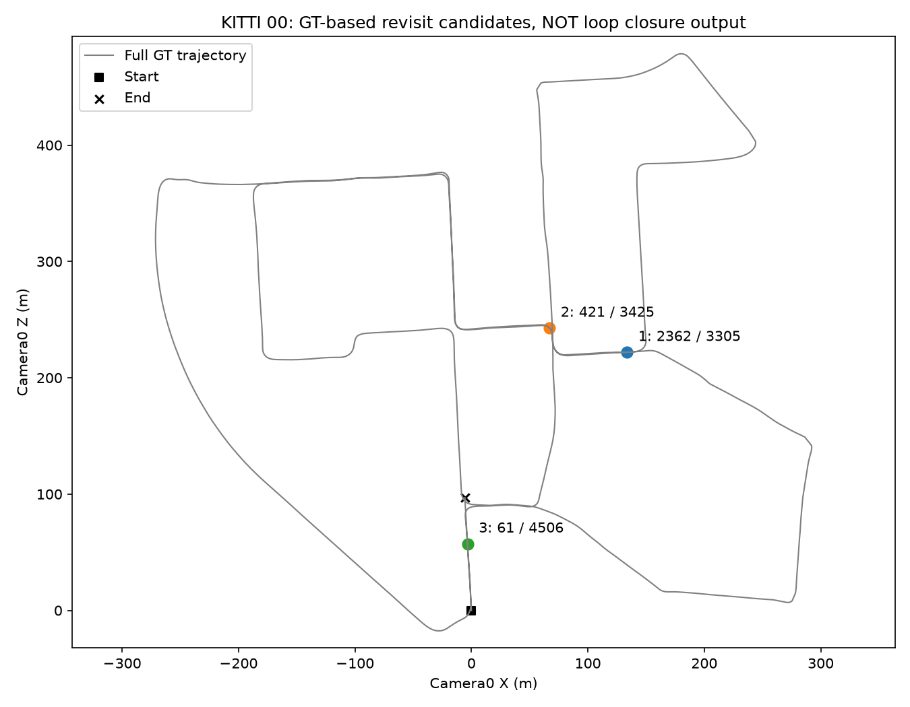
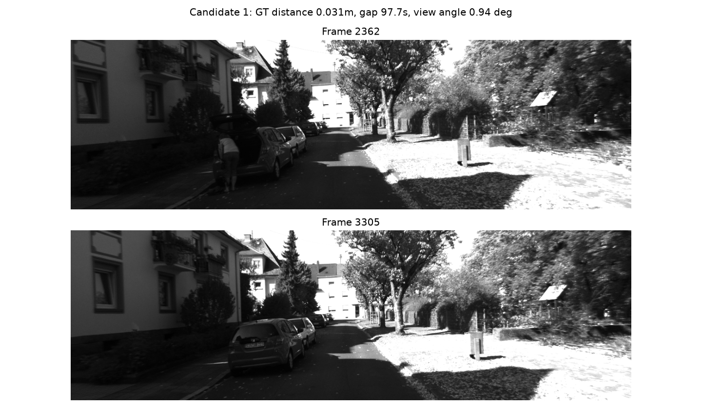
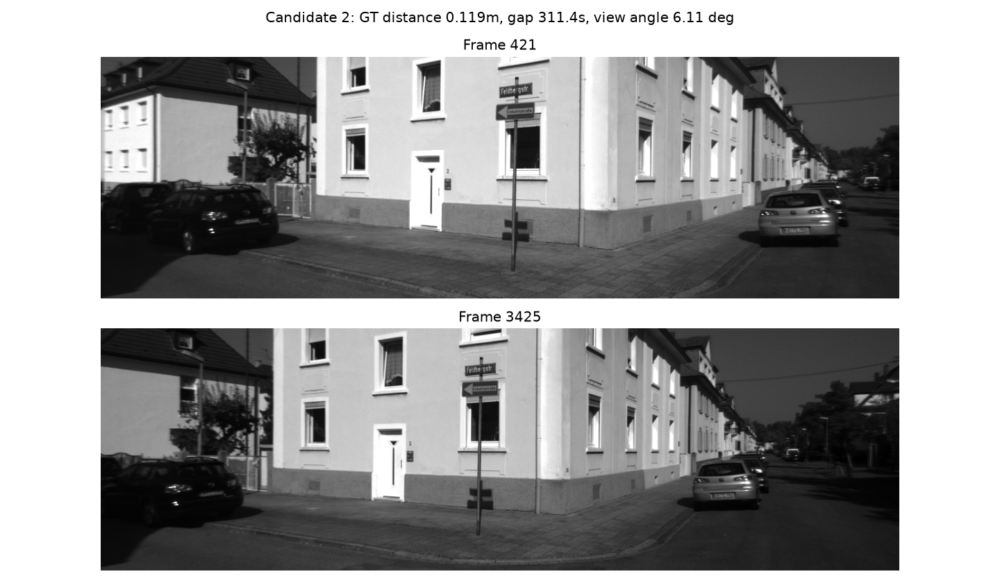
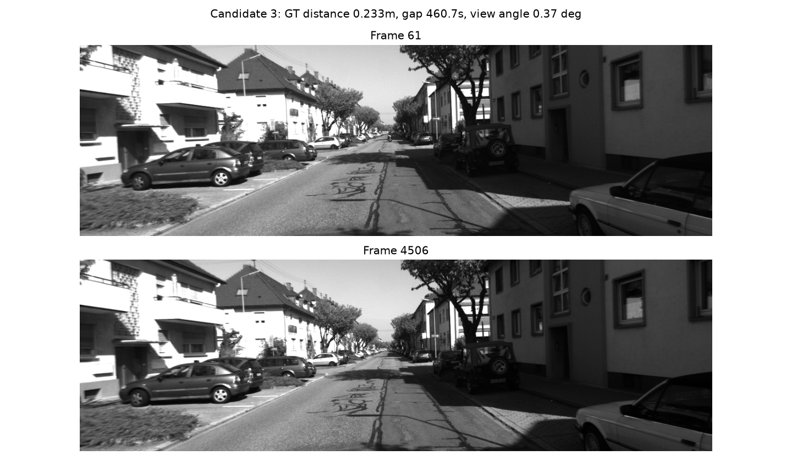

# KITTI 재방문 데이터와 VO / LO 비교 연구 보고서

## 1. 요약 (TL;DR)
- 문제: 현재 데이터에서 루프 연구가 가능한지 확인하고 VO/LO 비교 재생을 제공한다.
- 접근: 전체 GT의 공간·시간 조건으로 재방문 후보를 선정하고 실제 영상을 비교했다.
- 결과: 4,541프레임에서 조건에 맞는 11,772쌍, 공간적으로 분리한 대표 후보 3개를 확인했다.
- LO는 KISS-ICP 기반이며 첫 200프레임 비교 재생이 구현되었다. 자동 루프 검출과 전역 보정은 아직 없다.
- 다음 단계: 전체 시퀀스 LO baseline을 먼저 평가한 뒤 루프 검출·기하 검증·그래프 최적화를 연구한다.

## 2. 문제 정의
SLAM은 위치와 지도를 함께 추정하는 문제다. 루프 클로징은 재방문으로 누적 오차를 줄이는 구성 요소이지 SLAM의 필수 정의는 아니다. KITTI Odometry라는 이름이 SLAM 연구를 금지하거나 데이터 사용을 오도메트리로 제한한다는 뜻은 아니다.

현재 baseline은 단안 ORB VO와 KISS-ICP LO의 00 시퀀스 첫 200프레임 결과다. VO에는 지도·BA·루프가 없고, LO의 rolling local map은 전역 루프 최적화 지도와 다르다. 이번 입력은 00 전체 GT poses/times, 실제 왼쪽 영상, 기존 VO/LO 산출물이다. 출력은 후보 CSV/JSON, 영상쌍, 비교 재생 HTML, 본 PDF다.

성공 기준: [가정] 500프레임 이상 떨어지고 중간 이동 100m 이상, GT 거리 5m 이하, 상대 회전 30도 이하인 후보가 최소 1쌍 존재할 것. 재생/탐색/정렬 모드 전환과 두 화면 이동에 브라우저 오류가 없어야 한다. 조건은 공식 벤치마크 규격이 아니라 이번 데이터 탐색용 설정이다.

범위 밖: 전체 구간 odometry 재실행, 자동 place recognition, pose graph 최적화, VIO/LIO, 운영 파이프라인 통합. 실제 루프 성능 기준은 이후 별도 정의해야 한다.

## 3. 사용 가능한 리소스
| 리소스 | 확인 내용 | 부족한 것 |
|---|---|---|
| 데이터 | 00 grayscale stereo와 LiDAR 각각 4,541프레임, GT | 자동 루프 정답 라벨 |
| 기존 VO | ORB, Hamming 매칭, Essential RANSAC, recoverPose | metric scale, BA, 지도 |
| 기존 LO | KISS-ICP 1.3.0, metric 상대 이동 및 local map | 전역 그래프, 루프 검출 |
| Feature | ORB descriptor, LiDAR XYZ/intensity | 장소 검색 descriptor 및 검증 파이프라인 |
| 환경 | 연구용 Python venv, SciPy, OpenCV, Matplotlib, Chrome 검사 | 일반화 평가 및 전체 구간 실험 |

상세 인벤토리는 notes/inventory.md, VO/LO 알고리즘 단계 설명과 이미지는 ../20261031_vo-lo-study/report.pdf에 있다.

## 4. 접근 방법 선정
Quick-win으로 GT 위치의 cKDTree 근접 검색을 사용했다. 이는 '이 데이터에 재방문이 있는가'에 답할 수 있으므로 새 검출 알고리즘이나 선행연구 비교 실험은 수행하지 않았다. GT를 사용했기 때문에 실제 로봇의 loop detector로 사용해서는 안 된다.

근거 코드: src/audit.py:28 근접 검색, :31 시간·이동·회전 필터, :38 대표 선택, :63 실제 영상 읽기. 후보 수는 인접 프레임 조합을 포함하므로 11,772개의 독립 루프를 의미하지 않는다.

## 5. 시스템 아키텍처


| 모듈 | 입력 / 좌표계 / 단위 | 출력 계약 | 검증 |
|---|---|---|---|
| 후보 검색 | GT Nx3 위치, 첫 카메라 좌표계, m | artifacts/candidates.csv | 유한값, 시간 단조 증가, 필터 |
| 대표 선정 | 후보와 GT 회전, 초/도 | artifacts/summary.json | 40m 이상 공간 분리 |
| 영상 비교 | uint8 image_0 PNG, 프레임 인덱스 | figures/pair_*.png 및 artifacts/loops/index.html | 이미지 decode와 프레임 표시 |
| 동기 재생 | 기존 200프레임 영상·LiDAR·poses | 별도 study의 artifacts/playback/index.html | play/seek/mode, canvas, 모바일 |

LiDAR pose는 기존 연구에서 Tr로 카메라 좌표계로 변환했다. 본 후보 검색은 GT 좌표만 사용하며 추가 센서 동기화나 단위 변환은 없다. 생산 코드 변경 없이 연구 디렉터리와 VSCode 실행 설정을 추가했다.

## 6. 실험 설정
데이터: KITTI 00 전체 0~4540, 추정 비교는 0~199. 설정: configs/audit.json. 실행 당시 HEAD: eec870b84c856cbc117c879cd5ffa0cff578d020 및 이번 연구 파일 변경분. 정확한 구현은 이 보고서를 포함하는 기능 커밋에서 확인할 수 있다. GT SHA256: 90791a4113df979b149fa9e1104e960ea59f525a8318a202dbb6aec1a3d88793.

레포 루트에서 기존 데이터와 연구 환경을 준비한 뒤 실행한다. 전체 Python 패키지 버전은 ../20261031_vo-lo-study/configs/requirements-lock.txt를 참고한다.

```sh
research/20261031_vo-lo-study/.venv/bin/python research/20261031_vo-lo-study/src/run.py --stage all
```

기존 알고리즘 산출물이 있으면 HTML과 후보 분석만 재생성한다.
```sh
research/20261031_vo-lo-study/.venv/bin/python research/20261031_vo-lo-study/src/run.py --stage playback
node research/20261031_vo-lo-study/src/check_playback.mjs
node research/20261030_progress-review/src/render_pdf.mjs research/20261031_loop-readiness
```

브라우저 검사/PDF 도구는 macOS Chrome과 /tmp/kitti-report-pdf의 Playwright/marked/mermaid 설치를 사용한다. 이는 이 머신의 재현 조건이며 다른 OS에서 경로 조정이 필요하다. 대용량 데이터와 artifacts는 Git에서 제외하고 생성 코드를 커밋한다.

## 7. 결과
| 후보 프레임 | GT 거리(m) | 시간 간격(s) | 중간 이동(m) | 상대 회전(도) |
|---|---:|---:|---:|---:|
| 2362 / 3305 | 0.031 | 97.7 | 800.4 | 0.94 |
| 421 / 3425 | 0.119 | 311.4 | 2348.8 | 6.11 |
| 61 / 4506 | 0.233 | 460.7 | 3627.0 | 0.37 |

표는 GT 근접 후보이며 검출 정확도나 보정 성능이 아니다. 전체 이동은 3724.2m, 시작-끝 거리는 97.2m다.


전체 경로 중 재방문 후보의 위치를 표시한다. 추정 궤적이 아니다.


2362/3305의 실제 영상으로 건물·차량·도로 구조가 반복되는 장면을 확인할 수 있다.


421/3425를 나란히 표시하여 시점 및 장면 차이를 확인한다.


61/4506의 실제 영상 비교다. 첫 200프레임만으로는 이 재방문을 관측할 수 없다.

기존 첫 200프레임 평가 비교:
| 방법 / 정렬 정책 | 위치 RMSE(m) | 해석 |
|---|---:|---|
| ORB VO / GT 전역 Sim(3) | 5.336 | scale을 GT로 맞춘 사후 궤적 형상 |
| ratio VO / GT 전역 Sim(3) | 5.208 | 작은 개선이나 다른 지표 악화, 우월성 결론 불가 |
| KISS-ICP LO / GT 전역 Sim(3) | 0.209 | 동일 형상 비교 조건 |
| KISS-ICP LO / 시작점만 정렬 | 2.299 | metric 오차, 위 Sim(3) 수치와 구분 |

이 표는 이전 연구 산출물을 재사용하며 전체 KITTI 평가나 loop closure 효과가 아니다. 방법·평가 코드는 ../20261031_vo-lo-study/src/lo.py 및 evaluate.py다.

## 8. 분석
### 8.1 Feature 강점/약점
| Feature | 강한 조건 | 약한 조건 | 근거 |
|---|---|---|---|
| GT 위치 근접 | 재방문 데이터 존재 확인 | 실사용 시 GT 없음 | 위 후보 3쌍 |
| 상대 회전 필터 | 비슷한 시점 영상 선별 | 반대 방향 루프 제외 | 30도 제한 |
| 실제 grayscale 영상 | 반복 구조 정성 확인 | 조명, 동적 물체, 유사 장소 | pair_1~3 |
| LiDAR 기하 | metric odometry 비교 | 반복 구조, 움직이는 물체 | 이전 LO 보고서; 이번에는 loop 검증 미실시 |

### 8.2 알고리즘의 약점 및 실패 사례
GT 기준의 좋은 사례만 선정했으므로 자동 검색의 false positive/false negative는 측정하지 않았다. 가까운 GT 위치라도 가림이나 시선 차이로 정합이 실패할 수 있다. 프레임 간 연관으로 후보 개수는 크게 부풀 수 있다. 공식 KISS KITTI loader의 특수 scan correction과 deskew를 적용하지 않은 연구 설정이라는 한계도 유지된다.

### 8.3 문제 해결 정도
데이터 존재 기준은 대표 3쌍으로 달성했다. Chrome 검사에서 재생, 120번 프레임 탐색, 정렬 모드 변경, 후보 선택, 양방향 화면 이동을 통과했고 JavaScript 오류는 0건이었다. 390px 모바일에서 가로 넘침이 없고 영상 3개가 정상 decode되었다. camera/BEV/path canvas의 비영 픽셀은 각각 466611/34435/3076개였다. 단, 실제 loop 검출·보정의 성공은 미평가다. 비교 재생은 원시 센서와 추정 궤적을 관찰하는 도구이며 실시간 온라인 계산기가 아니다.

## 9. 개선 방향
| 보완 항목 | 기대 효과 | 예상 공수 |
|---|---|---|
| 전체 00 LO baseline | 루프 전 누적 오차 측정 | 중간 |
| 장소 검색 descriptor + 기하 검증 | GT 없이 후보 검색 및 오검출 배제 | 높음 |
| pose graph 최적화 | 검증된 루프를 통한 전역 보정 | 높음 |
| 추가 시퀀스 / 반대 시점 평가 | 선택 편향 확인 | 중간 |

## 10. 다음 단계 제안
1. 00 전체 LO와 지도 누적을 실행해 baseline을 확정한다.
2. LiDAR 루프 검출 방법을 조사·선정하고 후보 검색과 정합 검증을 각각 평가한다.
3. 검증된 루프 제약으로 pose graph를 최적화하고 보정 전후 재생을 비교한다.

## 부록
- [가정] 5m/500프레임/100m/30도/40m 분리 조건은 탐색 목적의 임시 조건이다.
- [미확인] GT 없는 자동 루프 precision/recall, 전체 구간 LO 정확도, loop 최적화 개선량.
- 근거: 로컬 GT 및 실제 영상, src/audit.py, artifacts/summary.json, artifacts/candidates.csv. 본 작업은 새로운 논문 성능 수치를 인용하지 않는다.
- 관련 알고리즘 원문과 단계별 실험은 ../20261031_vo-lo-study/report.pdf의 참고문헌 및 본문 참조.
