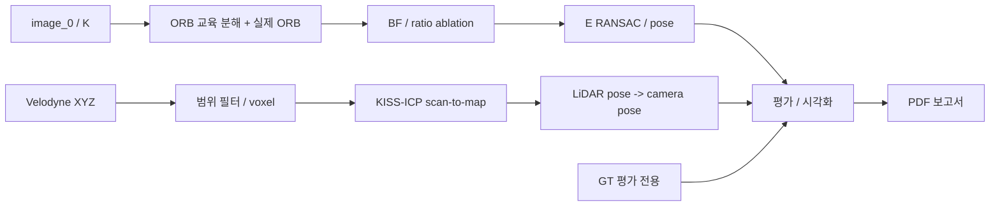

# Phase 5: 아키텍처

| 모듈 | 입력/단위/좌표/주기 | 출력 및 계약 | 검증 |
|---|---|---|---|
| ORB 교육 | uint8 grayscale pixels, 대표 frame | artifacts/orb/*; pyramid/FAST/Harris/angle/bits | synthetic warp GT와 실제 ORB descriptor 검사 |
| VO | 두 연속 영상 약10Hz / K | artifacts/vo/{baseline,ratio}/*; 4x4 camera0 poses, arbitrary units | mask/count, finite, detR, 동일 frame 수 |
| LO | float32 Nx4 XYZI, m, LiDAR frame 약10Hz | artifacts/lo/*; voxel/source/map/prediction/final pose | finite/SE3, 독립 ICP 잔차 진단 |
| 평가 | Nx4x4 GT/VO/LO, 같은 frame indices | artifacts/evaluation/*, figures/* | T_camera=Tr*T_lidar*inv(Tr), 시작 pose 정규화 |
| 보고 | 코드/로그/그림/자료 | report.md + report.pdf | 그림 누락/단위/원인 과장 검사 |

LO는 per-point timestamp가 없어 deskew를 끈다. IMU/GT는 추정에 입력하지 않는다.
metric LO는 GT 기반 scale 보정을 하지 않는다. 단안 VO는 임의단위 원본 + GT로 전역 Sim(3) 정렬한 진단을 분리한다.
비교는 전체 200프레임과 최저 품질 프레임을 포함하며 실패 프레임은 누락하지 않고 이전 pose 유지+상태 기록한다.
연구 src는 기존 src와 독립이며, 제품 통합 접점은 보고서 제안으로만 남긴다.
