# ORB 단계 해부와 LiDAR Odometry 비교 연구 보고서

작성: 2026-10-31 · KITTI Odometry 00, 프레임 0~199 · 연구 전용 구현.

## 1. 요약 (TL;DR)

- ORB를 피라미드→FAST→Harris→방향→binary descriptor→매칭→자세 추정으로 나눠 실제 이미지·배열을 생성했다.
- 공식 KISS-ICP 1.3.0을 연결해 IMU 없는 LO를 실행하고, 범위 필터·voxel·정합·로컬 지도와 교육용 ICP 반복을 기록했다.
- 동일 전역 Sim(3) 진단의 위치 RMSE: VO 5.336m, ratio VO 5.208m, LO 0.209m. GT scale 보정 없는 LO는 2.299m다.
- 이번 200프레임만으로 센서/알고리즘 일반 우열을 단정하지 않는다. 컬러·IMU 추가 실험과 loop-closed SLAM은 수행하지 않았다.
- 다음 선택은 Stereo VO, 매칭 후속 연구, LO 전처리/전체 구간 검증, IMU 정렬이다. 본 보고서 이후 자동 진행하지 않는다.

## 2. 문제 정의

### 2.1 무엇을 해결하는가

이전 보고서는 결과 그래프와 논문 링크 위주여서 **각 부품이 왜 필요한지, 입력이 어떻게 바뀌는지, 무엇이 실패하는지**를 학습하기 어려웠다. 이번에는 관측에서 pose까지의 중간 산출물을 남기고 동일 장면에서 VO와 LO를 실제 실행한다.

### 2.2 현재 baseline과 입출력

기존 VO는 단안 image_0에 ORB/BF Hamming/Essential RANSAC/recoverPose를 적용한 frame-to-frame 방법이다. t의 크기를 모르므로 매 이동 길이를 1로 둔다. `src/vo/features.py:4,13`, `src/vo/two_view.py:11`, `src/vo/run_kitti.py:38`이 근거다. 기존 알고리즘은 ORB-SLAM이 아니다.

연구 VO는 위 구성을 재현하되 프레임을 생략하지 않고 실패 시 이전 pose 유지/상태를 기록하며 최소 pose inlier 5개 gate를 둔다. 라이브러리 mask를 255로 가정하지 않고 nonzero로 센다. 이번 구간에는 hold가 없었다. 기존 제품 코드는 변경하지 않았다.

입력은 왼쪽 grayscale와 XYZ 스캔, 카메라 K, LiDAR→카메라 Tr이다. GT는 평가기에만 입력한다. 출력은 200개 pose, 단계별 NPZ/CSV, 이미지, 동기화 플레이백과 이 PDF다. IMU는 읽어 융합하지 않는다.

### 2.3 성공 기준과 범위

아래 표는 이번 요청의 검증 기준이다. 정확도 임계값이 사전에 주어지지 않았으므로 [가정] 동일 구간 baseline 비교로 효과를 판단한다.

| 기준 | 목표 | 결과 |
|---|---|---|
| 설명/단계 관찰 | ORB·VO·LO 각 주요 단계의 입력/출력/그림 | 충족; 교육용/실제 출력 구분 |
| 추정 로그 | frame 0~199 pose 보존, finite, det(R)≈1 | VO 두 종류/LO 충족 |
| 비교 공정성 | 좌표계·scale·GT 사용 정책 명시 | metric와 Sim(3) 표 분리 |
| 작은 개선 검증 | ratio gate를 baseline과 비교 | 일부 지표 개선, 회전/끝점 악화 |
| 실행 재현 | 설정/버전/명령/산출물 저장 | 본문 6절 및 artifacts |

제약은 macOS arm64 CPU, 200프레임의 짧은 주간 구간, 컬러/point별 timestamp 부재다. 범위 밖은 원 논문의 학습 데이터와 rBRIEF 학습 완전 재현, learned matcher 학습, VIO/LIO, loop closure, 제품 통합이다.

## 3. 리소스와 전체 구조

표는 실제 사용한 자원과 미사용 자원을 구분한다. 전체 목록: [notes/inventory.md](notes/inventory.md).

| 자원 | 보유/사용 | 의미 |
|---|---|---|
| image_0, image_1 | 좌우 각 4541장, 왼쪽만 사용 | Stereo 확장은 가능하지만 이번은 기존 단안 비교 |
| Velodyne 00 | 4541스캔 중 200 사용 | float32 XYZI, 좌표 단위 m |
| poses/00.txt | 평가에만 사용 | 추정 입력이나 map 정합에 사용하지 않음 |
| calib.txt | P0의 K, Tr 사용 | LO를 카메라 시작 좌표계로 변환 |
| image_2, image_3 | 없음 | 컬러 성능 개선 주장은 실험 불가 |
| Raw OXTS | 보유, 이번 미사용 | 별도 시간축 검증 필요 |

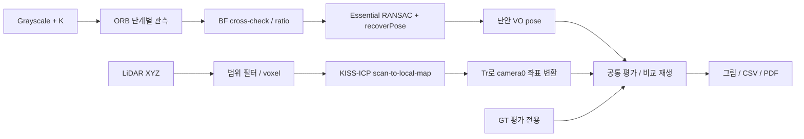

그림 1. 서로 다른 관측을 동일한 pose 평가 문제로 연결한다. VO의 관측 단위는 pixel, LO는 meter이며 지도·IMU를 공유하는 융합 시스템은 아니다.

## 4. 접근 선정과 알고리즘 해설

### 4.1 ORB는 무엇이며 무엇이 아닌가

ORB는 **다음 이미지에서도 다시 찾을 수 있는 위치를 고르고, 그 주변 모양을 작은 이진 문자열로 표현하는 방법**이다. 차량 위치를 직접 출력하지 않는다. 관측을 만드는 앞단이고, 위치 추정은 뒤의 기하 알고리즘이 한다.

논문은 Ethan Rublee, Vincent Rabaud, Kurt Konolige, Gary Bradski의 *ORB: An efficient alternative to SIFT or SURF*, ICCV 2011이다. 핵심은 FAST/BRIEF 계열을 방향과 규모 변화에 대응하도록 구성하는 것이다. [OpenCV 설명](https://docs.opencv.org/4.13.0/d1/d89/tutorial_py_orb.html)

이 연구는 **교육용 부분 재구현**과 **실제 OpenCV ORB**를 분리한다. `orb_stages.py`의 level-0 FAST/Harris/centroid와 무작위 BRIEF 쌍은 원 구현 전체와 동일하지 않다. 최종 VO에는 OpenCV ORB descriptor를 사용한다. 교육용 그림을 실제 내부 cache dump라고 부르지 않는다.

### 4.2 단계 1: 영상 피라미드

물체가 가까워지면 영상에서 커진다. 한 해상도에서만 작은 모서리를 찾으면 다음 프레임의 다른 크기와 연결하기 어렵다. 여러 크기의 영상을 준비하면 다양한 스케일에서 후보를 찾을 수 있다.

이번 교육 그림은 scale factor 1.2의 4개 레벨을 만든다. 실제 ORB 호출은 OpenCV 기본 8레벨을 사용한다. 입력은 uint8 영상, 출력은 레벨별 uint8 배열이며 `artifacts/orb/pyramid.npz`에 저장했다.

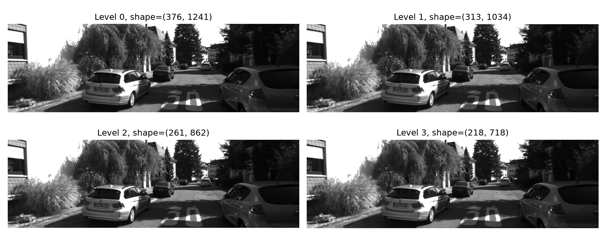

그림 2. 같은 장면의 크기를 줄인 레벨들. 이것은 깊이 지도나 3D 복원이 아니다. 피라미드는 크기 변화에 대한 표본화이지 임의의 3D 시점 변화에 대한 완전한 불변성은 아니다.

### 4.3 단계 2: FAST 후보와 Harris 선택

FAST는 중심 pixel 주변의 원형 이웃에서 일정 구간이 중심보다 충분히 밝거나 어두운지 검사해 corner 후보를 찾는다. 밝기 변화가 거의 없는 하늘·도로 내부는 후보가 적고, 문틀·창문·나뭇잎처럼 변화가 큰 부분은 후보가 많다.

후보를 모두 사용하면 비용이 커지므로 강한 corner를 선택한다. Harris의 직관은 작은 patch를 여러 방향으로 움직였을 때 밝기 패턴이 얼마나 변하는지다. 한 방향으로만 변하면 edge, 여러 방향으로 변하면 corner에 가깝다. 교육 구현은 `R = det(M) - 0.04 × trace(M)²`로 계산한 응답을 후보 위치에서 읽는다.

이번 frame 120의 FAST 후보는 **5475개**이고, 교육용 Harris 상위 **500개**를 표시했다. 실제 ORB의 2500개 선택과 달리 level-0만 사용하므로 두 집합이 같을 것으로 기대하면 안 된다. 좌표와 응답 배열은 `fast_harris.npz`다.

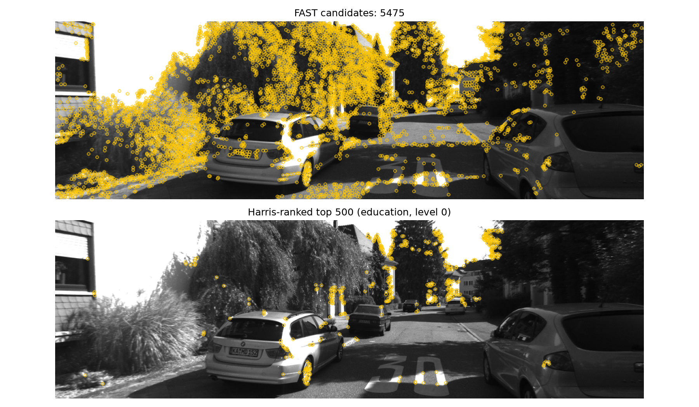

그림 3. 위는 후보, 아래는 교육용 강도순 선택. 점의 수가 많다고 공간 전체가 균일하게 관측되거나 정확한 매칭이 보장되는 것은 아니다.

### 4.4 단계 3: 방향 추정

카메라가 회전하면 같은 patch의 모양도 영상에서 회전한다. 그대로 descriptor를 만들면 같은 장소인데 다른 문자열이 된다. ORB는 patch의 밝기 중심이 어느 방향에 있는지 계산해 기준 방향을 만든다.

교육 구현에서 중심을 원점으로 한 원형 patch의 모멘트는 `m10=ΣxI(x,y)`, `m01=ΣyI(x,y)`이고 `θ=atan2(m01,m10)`이다. 출력은 각도와 방향 화살표이며 `centroid_angles.npy`에 저장했다. 실제 ORB에서 나온 angle은 `descriptors.npz`에 별도 저장했다.

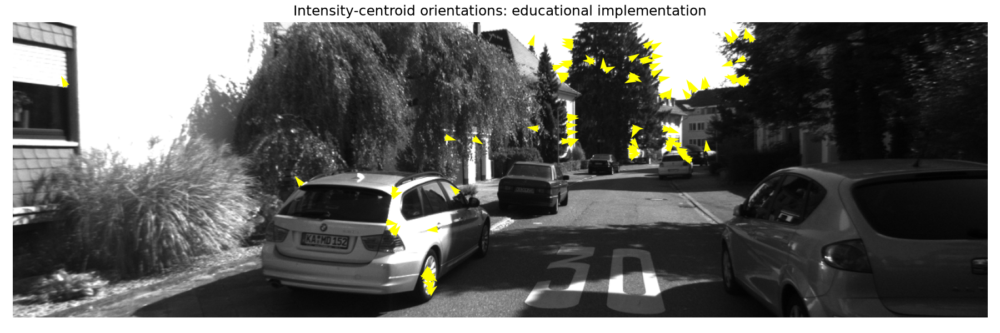

그림 4. frame 120 patch의 밝기 무게중심 방향. 대칭이거나 대비가 낮은 patch에서는 방향이 민감할 수 있다. 이 민감도의 실제 시퀀스별 빈도는 이번에 측정하지 않았다.

### 4.5 단계 4: BRIEF, steering, rBRIEF

descriptor는 작은 영상 자체를 저장하는 대신 두 위치의 밝기를 비교해 한 비트를 만든다. 예를 들어 `I(p)<I(q)`이면 1, 아니면 0이다. 256회 비교하면 256bit=32byte가 된다. 위치 쌍을 patch 방향만큼 함께 회전시키는 것이 steering이다.

무작위 비교 쌍이 모두 좋은 것은 아니다. 거의 항상 0인 비트는 구분력이 낮고, 서로 같은 일을 하는 비트는 중복이다. ORB의 rBRIEF 선택은 비트 분산과 상관을 고려한다. 이번에는 원 학습 절차나 학습 corpus를 재현하지 않았다. 그림 왼쪽의 무작위 쌍은 steering을 설명하기 위한 예이고, 오른쪽은 실제 OpenCV ORB의 32개 descriptor를 펼친 출력이다.

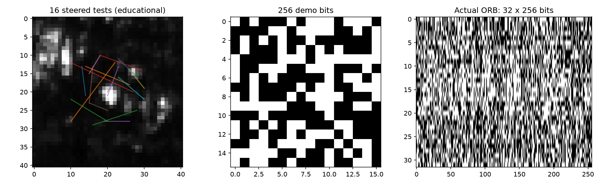

그림 5. 왼쪽은 교육용 회전된 비교 쌍, 가운데는 그 쌍으로 만든 비트, 오른쪽은 실제 ORB binary 배열. descriptor의 시각화는 특징점 지도나 의미 분류 결과가 아니다.

### 4.6 방향 보정은 실제로 도움이 되는가: 통제 실험

frame 120을 정확히 30도 회전한 합성 영상을 만든다. 알려진 affine 변환으로 매칭의 정답 pixel 위치를 계산하고 오차 3px 미만을 올바른 대응으로 정의했다. GT는 이 교육 실험의 label에만 사용했다.

같은 검출 위치에서 ORB 방향을 사용한 경우와 angle을 0으로 강제한 경우를 비교했다. 방향을 제거한 방법은 실제 baseline 개선안이 아니라 구성 요소의 역할을 보는 ablation이다.

| 설정 | 상호 최근접 매칭 수 | 알려진 변환 기준 정확 대응 비율 |
|---|---:|---:|
| 실제 ORB 방향 사용 | 1280 | 89.14% |
| 같은 위치, descriptor angle=0 | 388 | 1.03% |

표 1. 단일 합성 회전에서 방향 보정 효과. 실제 도로의 원근·가림·독립 물체 운동·조명 변화를 포함한 전체 성능으로 해석하면 안 된다.

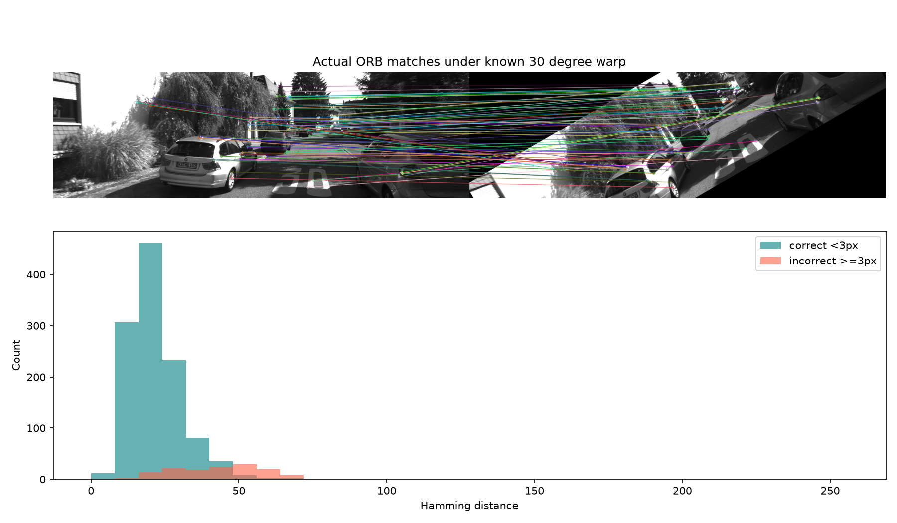

그림 6. 위는 실제 ORB 매칭 일부, 아래는 정답/오답별 Hamming 거리 분포. 겹치는 분포가 있으므로 거리 하나만으로 완벽한 판별이 불가능하다. 원시 자료는 `synthetic_rotation.csv`다.

### 4.7 단계 5: BF Hamming, cross-check, ratio test

Hamming 거리는 두 descriptor의 XOR에서 다른 비트 수다. BFMatcher는 후보를 비교해 작은 거리를 찾는다. cross-check는 A가 선택한 B가 반대로도 A를 선택할 때 유지한다. 이는 상호 선택이지 같은 3D 점이라는 증명은 아니다.

ratio test는 가장 가까운 거리 d1이 두 번째 거리 d2에 비해 충분히 작은지 본다. 이번 비교는 `d1 < 0.75 d2`로, cross-check baseline을 KNN ratio 방식으로 **대체**한 ablation이다. 둘을 동시에 적용한 것으로 해석하지 않는다. 두 방법 모두 거리순 상위 1000개를 사용한다.

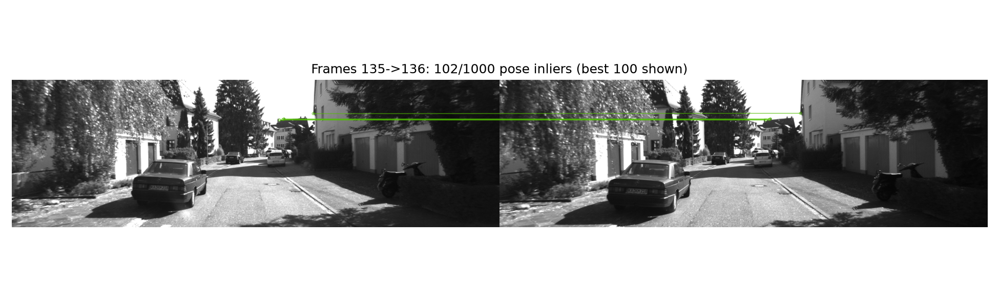

그림 7. frame 135→136의 pose inlier 중 거리순 상위 100개 범위만 표시했다. 전체 대응과 거리·mask는 `artifacts/vo/baseline/000136.npz`에 있으며 이 프레임의 pose inlier는 102/1000개다.

### 4.8 단계 6: Essential Matrix와 RANSAC

매칭에는 오답이 섞인다. RANSAC은 작은 대응점 집합에서 기하 모델을 가정하고 많은 관측과 일관되는 모델을 찾는다. 카메라 K로 정규화한 대응 x1,x2에는 `x2ᵀ E x1≈0`라는 제약이 있고 `E=[t]×R`이다. 한 점의 상대 영상 위치가 한 직선 위에 놓여야 한다는 뜻이다.

이번 구현은 OpenCV `findEssentialMat`, RANSAC prob=0.999, threshold=1 pixel을 사용한다. 출력 E, Essential inlier mask, 두 영상 pixel 좌표를 모두 NPZ로 저장했다. 실제 API는 `vo.py`에 있다.

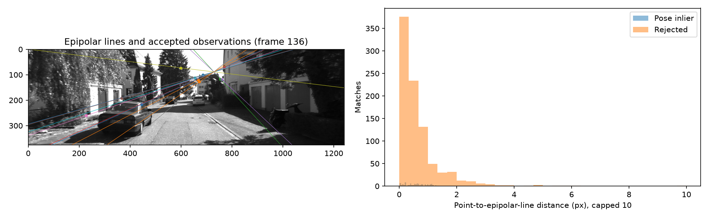

그림 8. frame 136의 epipolar line과 대응점, 점-직선 거리 분포. **pose에서 거절된 점의 중앙 거리가 더 작을 수도 있다:** 이번 inlier 중앙값 0.574px, 거절점 0.441px다. recoverPose는 epipolar 잔차만이 아니라 양의 깊이 등 기하 조건도 검사하므로 거절을 곧 오매칭 label로 취급하면 안 된다.

### 4.9 단계 7: recoverPose와 경로 누적

E에서 가능한 R,t 후보를 복원하고 점이 카메라 앞쪽에 놓이는 해를 고른다. t는 방향만 알려준다. `X_current=R X_previous+t`이면 카메라 world pose는 상대 변환의 역행렬을 곱해 누적한다.

출력은 full 4×4 pose 배열이다. 개별 R,t와 E도 저장했다. 여기서 모든 프레임의 이동 길이를 1로 두면 차가 감속해도 추정 이동량은 1이다. 이것이 현 baseline의 구조적 scale 한계다. 좋은 descriptor만 넣어도 사라지지 않는다.

### 4.10 ORB의 한계에서 어떤 후속 연구로 이어지는가

다음은 특정 논문이 바로 이전 논문을 완전히 대체한다는 연대기가 아니라 **해결하려는 문제가 다른 연구 갈래**다. 이번에 실행하지 않은 방법은 분명히 표시한다.

| 관찰/한계 | 관련 연구와 핵심 변화 | 필요한 것 / 남는 한계 | 이번 상태 |
|---|---|---|---|
| 손으로 정한 관측의 반복성 | SuperPoint(DeTone 외, 2018): 검출과 descriptor를 함께 학습, homographic adaptation | 모델/학습 분포; 모든 장면 일반화 보장 안 됨 | 조사만 |
| 개별 descriptor 최근접의 모호함 | LightGlue(Lindenberger 외, 2023): 집합 문맥을 이용한 매칭, 난이도별 계산 조절 | 호환 feature/weights; metric scale은 별개 | 조사만 |
| 희소 corner 의존 | DSO(Engel 외, 2016 preprint): 광도 오차로 sparse 관측·깊이·pose 최적화 | 광도/노출 모델; 밝기 변화와 모델 오차 | 조사만 |
| 2-view drift·지도 부재 | ORB-SLAM2(Mur-Artal/Tardos, 2017): keyframe/map/BA/loop 관리 | 지도 관리·최적화 구현 | 조사만 |
| scale 미관측 | Stereo triangulation + PnP: 깊이를 metric 3D로 관측 | 좌우 대응/보정/깊이 품질 | 다음 후보 |

표 2. Feature와 estimator와 SLAM backend는 다른 책임이다. 논문별 입력·적용성은 notes/prior_work.md 및 참고문헌에 있다. 이번 ratio 실험에서 위치 RMSE만 소폭 좋아지고 다른 지표가 나빠진 사실은 단일 지표 최적화의 위험을 보여준다.

## 5. LiDAR Odometry: 같은 깊이로 단계별 보기

### 5.1 LO는 무엇을 최적화하는가

카메라는 물체의 투영을 본다. LiDAR는 이미 meter 단위 3D 점을 제공한다. LO는 현재 점들을 이전 점군/지도에 맞추는 회전과 이동을 찾는다. 가장 단순한 목적은 대응 q에 대해 `Σ ||R p + t - q||²`를 줄이는 것이다. 대응이 알려져 있지 않아 대응 찾기와 변환 갱신을 반복한다.

이번 실행은 **공식 KISS-ICP 1.3.0의 핵심 pipeline**이다. 자체 신규 LO나 LOAM의 재현이 아니다. 별도로 이해를 위한 fixed-gate nearest-neighbor/SVD ICP를 저장된 실제 scan-map 쌍에 구현했다. 이 교육용 반복을 KISS C++ 내부 iteration log로 부르지 않는다.

### 5.2 단계 1: XYZI 읽기와 범위 필터

각 .bin은 Nx4 float32의 x,y,z,intensity다. XYZ는 LiDAR 좌표계에서 x 전방/y 왼쪽/z 위쪽이다. intensity는 이번 정합 비용에 사용하지 않는다. 너무 가까운/먼 관측은 불안정하거나 비용 대비 효과가 낮을 수 있어 이번 실험은 5~100m를 사용했다.

입력 전체 스캔과 실제 KISS preprocessor 출력은 대표 프레임의 `artifacts/lo/000120.npz`에 저장된다. timestamp 기반 deskew는 **비활성화**했다. Odometry bin에 점별 시간 필드가 없고, 임의 시간 복원을 넣지 않기 위해서다.

### 5.3 단계 2: Voxel 표본화

공간을 격자로 나눠 점 수를 줄인다. 그대로 모든 점을 사용하면 가까운 표면의 많은 점이 계산과 목적함수를 지배할 수 있다. 이번 KISS 설정의 map voxel은 1m, 내부 map 추가용 downsample은 0.5m, registration source는 1.5m다. 설치된 `KissICP.voxelize`에서 확인했다.

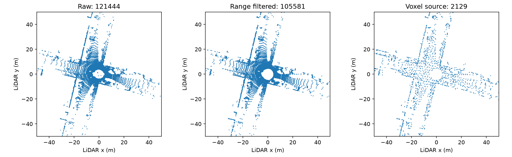

그림 9. frame 120의 원본→범위 필터→registration source. 각 점 개수는 그림 제목과 frames.csv에 있다. 같은 XY 범위를 그려 시각적 밀도를 비교한다. 큰 voxel은 비용을 줄이지만 작은 구조를 없앨 수 있다. voxel-size ablation은 미수행이다.

### 5.4 단계 3: 운동 예측과 대응점

정합은 초기값에 민감하다. KISS는 직전 상대 운동을 다음 시점에도 적용하는 예측을 초기 pose로 사용한다. 이 예측은 IMU를 사용한 예측이 아니라 이전 LO 결과에 기반한다.

현재 source를 예측 pose로 변환해 local map과 대응시킨다. 너무 먼 대응은 배제하고 residual이 큰 관측의 영향은 robust kernel로 줄인다. KISS의 threshold σ는 예측과 실제 추정의 차이에 따라 갱신되며, 이번 설치 코드의 correspondence gate는 `3σ`, kernel 인자는 `σ`다. σ의 실제 시계열은 `artifacts/lo/frames.csv`에 저장된다.

### 5.5 단계 4: 정합 반복과 pose 갱신

교육용 ICP는 다음 순서를 20회 실행한다: 현재 pose로 source 변환 → KD-tree 최근접 대응 → 1m gate → 중심을 뺀 대응의 cross-covariance → SVD로 R → 중심 차이로 t → pose 누적. reflection이면 det(R)=+1이 되도록 수정한다. 각 반복의 residual/대응 수/회전·이동 갱신을 CSV에 남긴다.

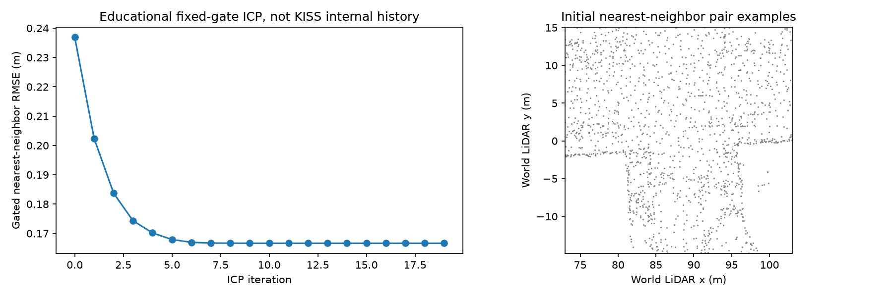

그림 10. frame 120 실제 scan-map에서 교육용 ICP의 gated 최근접 RMSE가 0.237m에서 0.167m로 줄었다. 매 반복 대응 집합이 달라지므로 고정 대응 비용의 단조 감소 보장은 아니며, 낮은 잔차 자체가 올바른 pose의 증명도 아니다.

실제 KISS는 robust registration backend를 사용한다. 보고서의 다음 거리 분포는 저장한 pose 전후에 SciPy KD-tree로 **독립 재계산한 진단**이고 KISS 내부 correspondence/가중치의 직접 dump가 아니다.

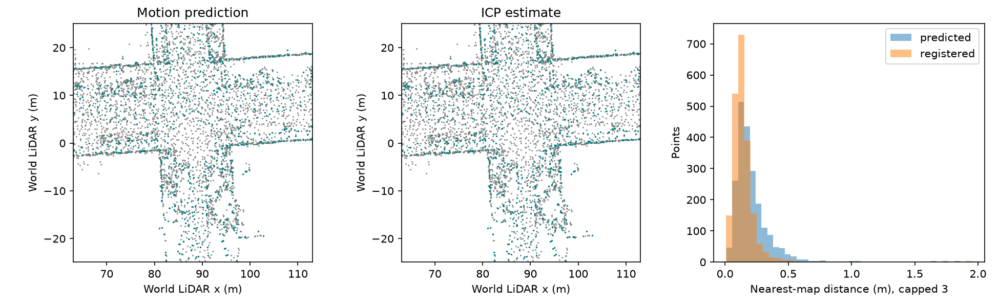

그림 11. 회색은 과거 local map, 청록은 현재 source. 예측과 최종 pose를 같은 공간에서 비교한다. 오른쪽은 최근접 거리 분포로 큰 거리는 3m에 모아 표시했다. 이전 source/target/pose와 거리 배열은 NPZ에 있다.

### 5.6 단계 5: 로컬 지도 갱신

최종 pose로 downsample 스캔을 map에 추가하고 센서에서 멀어진 점을 관리한다. 모든 과거 점을 영구 보관하는 전역 지도와 다르다. 그림은 200프레임 후 rolling local map이며 loop closure로 보정된 완전한 SLAM 지도가 아니다.

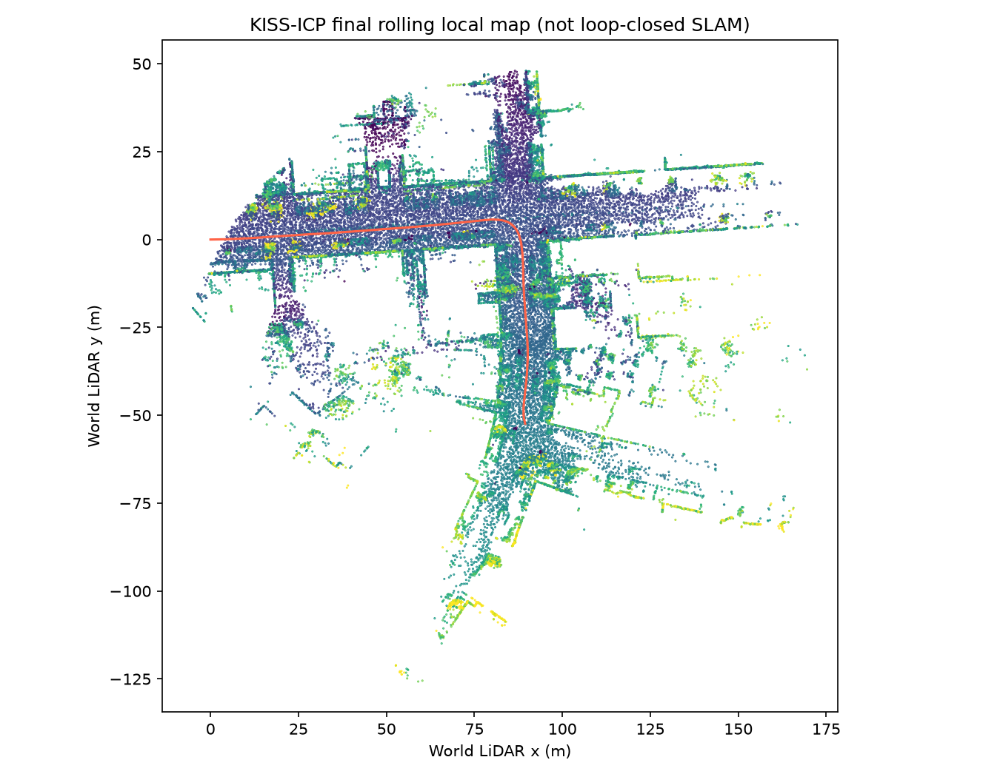

그림 12. 높이로 색칠한 LO 로컬 점군과 센서 경로. `final_local_map.npy`로 실제 3D 점을 제공한다. 색은 높이이지 카메라 RGB가 아니다.

### 5.7 LO의 한계와 관련 후속 연구

| 한계 | 관련 연구 / 접근 | 얻는 것 | 새로 필요한 것과 한계 |
|---|---|---|---|
| 전체 점 정합의 비용·geometry 활용 | LOAM(Zhang/Singh, RSS 2014): edge/plane 특징과 odometry/mapping 분리 | 구조적 제약 활용 | feature quality/센서 가정; 이번 미실행 |
| 단순 ICP의 outlier·초기값 민감도 | KISS-ICP(Vizzo 외, RA-L 2023): 표본화·적응 gate·robust 정합·운동 예측 조합 | 순수 LiDAR baseline | geometry 부족/동적 물체/나쁜 초기값에서 실패 가능 |
| 빠른 운동과 스캔 시간차 | FAST-LIO2(Xu 외, 2021 preprint): LiDAR와 IMU 결합, 직접 map 정합 | 고주파 운동 예측과 융합 | 정확한 시간/외부 보정/bias 모델 필요 |
| 장기 drift | loop detection + pose graph/global optimization | 재방문 제약으로 일관성 개선 | false loop 위험; 이번 미구현 |

표 3. LOAM은 KISS보다 오래된 다른 설계 갈래다. “KISS 다음에 나온 논문”이라는 뜻이 아니다. 이번 KISS 실행도 공식 KITTI loader의 별도 scan correction을 적용하지 않은 core 실험이며, 공식 논문/벤치마크 수치 재현으로 주장하지 않는다.

## 6. 실험 설정과 재현

| 항목 | 설정 |
|---|---|
| 데이터 | KITTI 00, 0~199, 동일 인덱스 이미지/LiDAR |
| VO | ORB 2500, match limit1000, RANSAC1px/prob0.999, seed7+frame |
| ratio variant | cross-check 대신 KNN d1<0.75d2 |
| LO | KISS-ICP1.3.0, voxel1m, range5~100m, deskew false, C++ threads4 |
| GT | 추정에는 미사용, 평가에만 사용 |
| Metric transform | T_camera(t)=Tr × T_lidar(t) × inverse(Tr), 첫 pose 정규화 |
| Shape 진단 | 각 방법에 전체 구간 GT 사용한 global Sim(3) least squares |
| 환경 | Python3.11 arm64, 연구 전용 .venv, pinned lock 저장 |

표 4. 기준 설정. 상세 설정 `configs/experiment.json`, 실제 KISS 설정 `artifacts/lo/effective_config.json`. GT 위치로 fit한 scale은 추정 입력이 아니라 사후 진단이며, 그 결과를 metric VO로 부르지 않는다.

기준 Git HEAD는 `c1b5ff7e3af1525061166953afb6caab855f11c8`이다. 이번 연구 코드는 아직 별도 커밋되지 않았다. 환경/설정·calibration hash는 `artifacts/evaluation/environment.json`에 저장한다. full dependency는 `configs/requirements-lock.txt`다.

레포 루트에서 실행한다. 기존 제품 .venv는 변경하지 않았다.

```bash
uv venv --python 3.11 research/20261031_vo-lo-study/.venv
uv pip install --python research/20261031_vo-lo-study/.venv/bin/python \
  -r research/20261031_vo-lo-study/configs/requirements-lock.txt
source research/20261031_vo-lo-study/.venv/bin/activate
export MPLCONFIGDIR="$PWD/.cache/matplotlib"
export XDG_CACHE_HOME="$PWD/.cache"
python research/20261031_vo-lo-study/src/orb_stages.py
python research/20261031_vo-lo-study/src/vo.py
python research/20261031_vo-lo-study/src/lo.py
python research/20261031_vo-lo-study/src/evaluate.py
python research/20261031_vo-lo-study/src/geometry_stages.py
python research/20261031_vo-lo-study/src/playback.py
```

PDF 생성에는 기존 `research/20261030_progress-review/src/render_pdf.mjs`에 이 연구 폴더 경로를 인자로 전달한다. 이 렌더러는 Chrome과 `/tmp/kitti-report-pdf/node_modules`의 marked/playwright/mermaid가 필요하다. PDF 생성 환경은 알고리즘 환경과 분리된다.

### 모듈별 산출물 계약

표의 NPZ/CSV는 실제 저장된 값이다. 모든 대표 프레임은 configs의 목록으로 고정했다.

| 모듈 | 타입·단위·좌표 | 저장 경로 | 검증 |
|---|---|---|---|
| ORB 교육 | images uint8, xy pixels, angles radians, bits bool | artifacts/orb/* | 실제 descriptor shape와 synthetic warp label |
| VO | Nx2 pixel, E/R/t, masks, 4x4 camera0 arbitrary pose | artifacts/vo/baseline,ratio | finite/SE3/frame count, 실패 상태 |
| LO | Nx3 m LiDAR/world, 4x4 pose, sigma m | artifacts/lo/* | finite/SE3, scan0 pose 정규화 |
| Geometry | epipolar distance px, ICP residual m | artifacts/geometry/* | 기록된 입력으로 직접 재계산 |
| Evaluation | full pose, 위치 m, 각도 degree | artifacts/evaluation/* | GT=self zero error, 알려진 similarity 복원 테스트 |
| Playback | embedded JPEG/points/trajectories | artifacts/playback/index.html | 브라우저 재생/seek/mode/canvas 검사 |

## 7. 결과: VO와 LO를 어떻게 비교했는가

### 7.1 Metric LO와 shape 진단을 구분

단안 VO에 실제 scale이 없으므로 raw 숫자를 미터로 간주한 RMSE를 발표하지 않는다. 먼저 LO만 시작 좌표계가 같은 GT와 직접 비교하고, 다음에는 VO·LO 모두에 동일한 전역 Sim(3) fit을 적용해 경로 모양을 비교한다. 후자는 GT를 보고 유리하게 정렬한 **사후 진단**이다.

| 방법 / 평가 정책 | 위치 RMSE m | 끝점 오차 m | 1-frame 상대 이동 RMSE m | 상대 회전 RMSE deg |
|---|---:|---:|---:|---:|
| LO, 시작 좌표계만 일치 | 2.299 | 2.964 | 0.0387 | 0.0905 |
| VO baseline, GT Sim(3) | 5.336 | 3.772 | 0.2772 | 0.6554 |
| VO ratio, GT Sim(3) | 5.208 | 5.845 | 0.2854 | 0.9836 |
| LO, GT Sim(3) | 0.209 | 0.312 | 0.0385 | 0.0905 |

표 5. 같은 200프레임의 실측. Sim(3) fitted scale은 VO 0.73054, ratio0.76298, LO1.00180이다. LO의 2.299→0.209 변화는 scale만의 효과가 아니라 전역 회전/이동 정렬도 포함한다. 자세 원점 정렬 외 GT 보정을 하지 않은 수치는 첫 행이다.

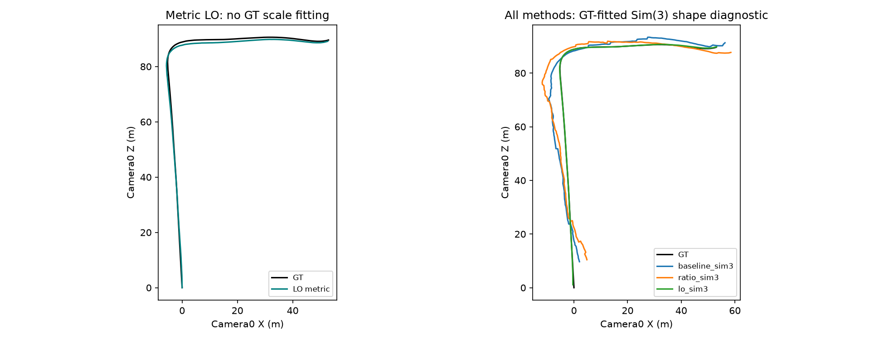

그림 13. 왼쪽은 metric LO, 오른쪽은 모든 방법의 사후 shape 정렬. 이번 LO가 이 구간에서 더 작은 오차를 보였지만 정교한 stereo/VIO/SLAM보다 낫다는 실험은 아니다.

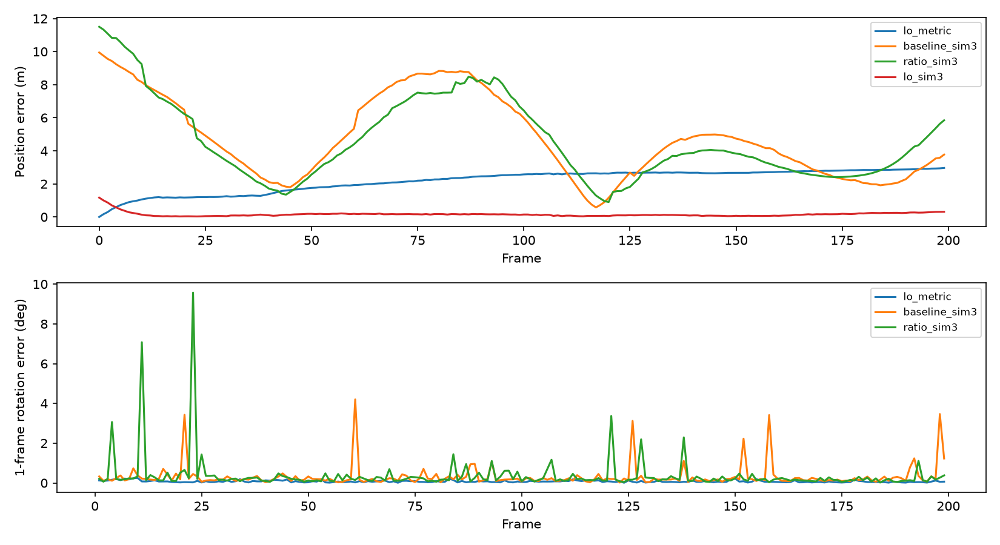

그림 14. 위치 오차와 1-frame 상대 회전 오차. 짧은 translation RPE와 전체 누적 위치 오차는 다른 성질이다. KITTI 공식 100~800m segment 평균 benchmark를 실행한 것은 아니다.

### 7.2 작은 해결책: ratio test의 결과

VO baseline과 ratio 모두 199개 전이에서 pose를 반환했다. pose inlier 중앙 비율은 baseline58.2%, ratio56.6%; 최저 비율은 둘 다 frame136에서 10.2%, 7.0%였다. ratio가 이 구간에서 더 좋은 관측만 골랐다고 결론 낼 근거가 없다.

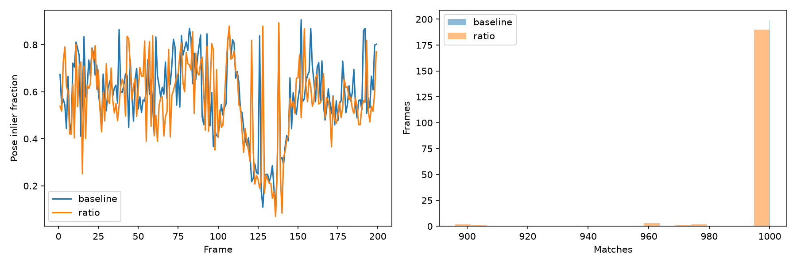

그림 15. pose inlier 비율과 매칭 수 분포. inlier 비율은 실제 정답 precision이 아니다. ratio의 위치 RMSE는 약 2.4% 낮지만 끝점/상대 이동/회전 지표는 악화됐다. 따라서 전체 개선으로 채택하지 않는다.

시간은 코드 내 추정 구간의 관측값으로 VO baseline 중앙64.1ms, ratio37.0ms, LO9.7ms였다. 영상/스캔 읽기·artifact 저장·그리기는 제외했고, 최초 실행에서 다른 연구 프로세스가 일부 겹쳤으며 thread 수와 구현 언어도 다르다. **공정한 latency benchmark나 실시간 보장은 아니다.** 시간 로그는 제공하지만 성능 순위의 근거로 사용하지 않는다.

### 7.3 LiDAR와 영상은 같은 것을 보고 있는가

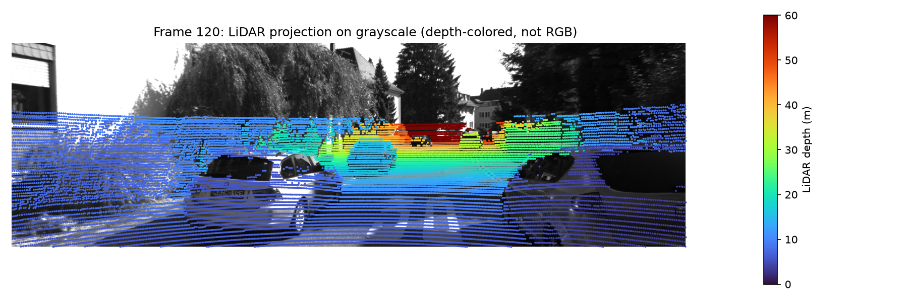

그림 16. frame120의 XYZ를 Tr/K로 영상에 투영했다. 색은 깊이이며 컬러 영상이 아니다. 이 그림은 대략적인 extrinsic 일관성 점검이고 동적 물체의 세밀한 시간 정렬을 보증하지 않는다.

[VO·LO 동기 비교 재생 열기](artifacts/playback/index.html)

플레이백은 raw grayscale/LiDAR 투영/ORB 대응점, 현재 스캔 BEV, GT·VO·LO 누적 궤적을 같은 frame index로 갱신한다. 재생/일시정지/이전·다음/seek/속도/metric·shape 전환을 제공한다. 브라우저에서 파일을 직접 열 수 있고 서버·인터넷이 필요 없다. 사전 계산 결과를 재생하는 것이며 online estimation UI는 아니다.

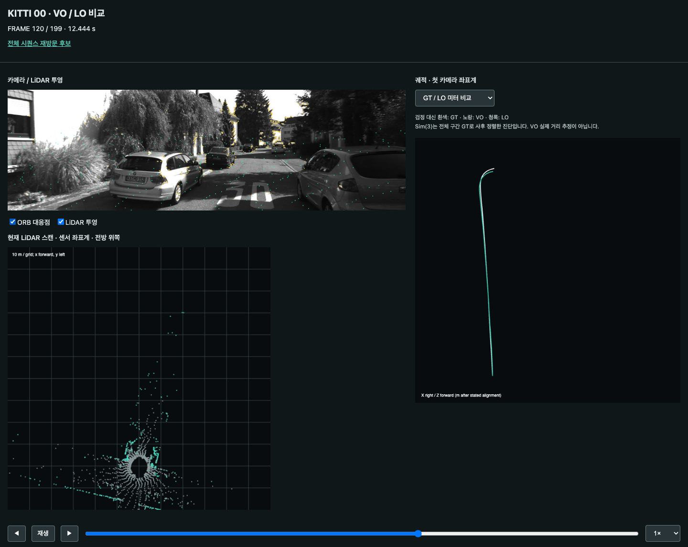

그림 17. frame120의 비교 재생 화면. 점군은 표시용으로 균일 stride 표본화했고 실제 정합 입력은 별도로 저장했다.

## 8. 분석: 강점·약점과 이번에 알 수 없는 것

### 8.1 Feature별 강약점

| 관측/표현 | 확인한 강점 | 약점·한계 | 근거 |
|---|---|---|---|
| ORB 방향+binary | 합성 회전에서 정확 대응89.14% | 단일 warp 실험; 3D 시점/조명/가림 일반화 불가 | 표1/그림6 |
| Hamming/cross-check | 작은 descriptor로 많은 대응 생성 | 반복 구조와 모호한 후보; 기하 검증 필요 | frame136/거리 분포 |
| ratio gate | 위치 RMSE 약간 감소 | 상대 회전 및 끝점 악화 | 표5/그림15 |
| LiDAR XYZ | metric 공간 제약으로 작은 상대 오차 | 긴 평면/동적 물체/초기값 실패 가능성 [가정] | 이번 수치와 미시험 조건 구분 |
| voxel source | 원본보다 작은 정합 집합 | 세부 구조 소실과 voxel 편향 가능성 [가정] | 그림9; size ablation 없음 |
| intensity | 파일에 존재 | 이번 cost에 사용하지 않아 효과 미확인 | lo.py XYZ만 입력 |
| IMU | 고주파 보조 관측 가능 | 시간축 이상/bias 확인 전 | 기존 회고 보고서, 이번 미사용 |

### 8.2 실패·한계 사례

- VO의 frame136은 많은 대응이 pose 복원에 기여하지 못했다. 단순 Hamming 또는 epipolar 거리만으로 원인을 설명할 수 없다. 동일 장면에서 ratio도 악화됐다.
- 고정 단위 이동량은 차량 속도 변화를 표현하지 못한다. 전역 scale fit으로도 모든 구간의 왜곡은 없어지지 않는다.
- LO도 GT 보정 없이 누적 위치 RMSE2.299m이며 완벽하지 않다. deskew off, 공식 KITTI scan correction 미적용, 초기 회전/정합 편향 등이 후보이나 기여도를 분리한 ablation은 하지 않았다.
- KISS C++의 모든 iteration/correspondence를 dump하지 않았다. 교육용 ICP와 독립 nearest-map 잔차를 대체 관찰로 제공했고 이를 실제 내부 출력이라고 표현하지 않았다.
- 연구 VO의 실패 hold 정책과 seed/thread 설정은 과거 exporter와 완전히 동일하지 않다. 이번 비교 표는 이번 재실행끼리 비교한다.
- 순수 frame index 대응은 Odometry camera/LiDAR에 한정한다. Raw OXTS를 같은 숫자로 연결하지 않았다.
- 200프레임만으로 장거리 loop closure/재위치추정/야간/비·안개/급격한 운동을 평가할 수 없다.

### 8.3 해결 정도

사용자의 핵심 요청인 알고리즘 설명→단계 산출물→한계→후속 접근을 구현/그림/평가와 연결했다. VO/LO의 비교와 실제 local map도 제공한다. 완전 ORB/후속 learned 논문 재현이나 full SLAM의 구현까지 완료한 것은 아니다. 후속 연구를 설명한 뒤 자동으로 모두 구현하지 않고 다음 선택지로 남긴다.

## 9. 질문에 대한 답: 컬러, IMU, SLAM

### 9.1 Gray 대신 컬러면 더 좋아지는가

**자동으로 좋아지지 않는다.** 현재 ORB는 밝기 패턴 기반이므로 컬러를 받아 grayscale로 바꾸면 색 정보를 이용하는 새 알고리즘이 되지 않는다. 같은 밝기의 다른 색을 구분하는 관측이나 semantic masking, 색을 이용한 map 정합을 설계해야 색의 효과가 생긴다.

컬러의 장점 후보는 객체 의미 분류·동적 객체 masking·색이 있는 지도다. 단점 후보는 처리량/메모리/노출·white balance 변화이며, 이 프로젝트에서 그 효과는 측정하지 않았다. KITTI의 컬러 영상은 별도 센서와 calibration을 사용하므로 grayscale 비교를 단순 채널 수 차이로만 통제하기도 어렵다. 현재 로컬에 컬러가 없어 ablation을 했다고 말할 수 없다.

다음 개선의 우선순위는 컬러 다운로드보다 **기존 우측 영상의 stereo 깊이**다. 이 판단은 현재 구조의 scale 미관측과 이미 보유한 데이터에 근거한다. 이후 실제 task가 semantic map이라면 컬러가 다른 가치를 갖는다.

### 9.2 IMU 데이터는 안 써도 되는가

**순수 VO/LO는 IMU 없이 가능하며, 이번 실험도 사용하지 않았다.** KISS-ICP의 운동 예측은 직전 LO의 변환을 활용한다. IMU가 없다는 이유로 LO가 meter scale을 잃지는 않는다. LiDAR가 이미 거리를 측정하기 때문이다.

IMU는 빠른 회전·짧은 시각 실패·scan 내 움직임을 다룰 보조 제약을 제공할 수 있지만 bias와 적분 drift가 있고 calibration/time offset/중력 처리가 필요하다. 센서를 하나 더 붙인다고 무조건 오차가 줄지 않는다. 현재 OXTS의 비양수 시간 간격5개와 긴 gap을 해결하지 않은 채 preintegration에 입력하면 오히려 잘못된 모델이 된다.

VIO/LIO는 별도 연구 단계다. 입력은 가속도/각속도이며 OXTS의 GPS/INS 위치·자세를 섞으면 GT 누출 우려가 있다. MLE/MAP, 공분산, residual weighting은 그 융합에서 관측의 신뢰도를 표현하는 도구가 된다.

### 9.3 KITTI Odometry로 SLAM 연구는 못하는가

**SLAM 연구도 할 수 있다.** 데이터셋 이름이 알고리즘을 odometry로 제한하지 않는다. 연속 영상/스캔으로 pose와 지도를 만들고 keyframe/BA/loop closure/재위치추정을 연구할 수 있다. 공식 페이지 이름도 Visual Odometry / SLAM Evaluation이다.

다만 평가에서 주어지는 주된 GT는 궤적이다. 지도 정확도를 정량 평가하려면 별도 기준 map·평가 방법이 필요하다. loop closure 효과를 보려면 실제 재방문이 있는 충분히 긴 구간이 필요하며 이번 0~199프레임은 그 실험이 아니다. SLAM에 loop closure가 정의상 항상 필수인 것은 아니지만 전역 일관성·장기 drift를 다루는 대표 기능이다.

이번 rolling local map은 LO의 scan-to-map 추정을 지원한다. 지도 그림이 있다는 사실만으로 loop-closed SLAM을 구현했다고 하지 않는다. KITTI 전체 00을 활용한 장기 지도/재방문 연구는 다음 단계로 분리한다.

## 10. 개선 방향과 다음 단계 선택

| 우선순위 | 다음 연구 | 기대 효과 [가정] | 공수 [가정] |
|---|---|---|---|
| 1 | Stereo 깊이→PnP VO, 같은 LO/GT와 metric 비교 | 단안의 scale 한계를 직접 해소 | 중간 |
| 2 | LO deskew/scan correction/voxel 및 긴 구간 ablation | 이번 LO의 잔여 오차 원인 분리 | 중간 |
| 3 | ORB vs learned feature/matcher 비교 | 실제 모호한 관측에서 개선 여부 확인 | 중간~높음 |
| 4 | IMU 시간축/축/노이즈 검증 후 VIO 또는 LIO | 고속·관측 약화 조건의 융합 준비 | 높음 |

표 6. 모두 사용자 선택을 위한 제안이다. 실험하지 않은 효과를 보장하지 않는다. 기존 src 통합이나 자동 리팩터링은 하지 않았다. 교육 순서는 관측→대응→잔차→최적화→누적 오차→추가 센서/지도 제약으로 이어진다.

## 부록

### 가정과 미확인

- [가정] 정량 목표가 지정되지 않아 동일 구간 baseline 비교를 사용했다. production latency 목표는 없다.
- [가정] 컬러·IMU·grid·stereo·learned matcher 개선 효과는 본 실험 밖이다.
- [미확인] 장거리/다른 시퀀스 일반화, 동적 객체별 GT, scan 내부 time 및 motion distortion의 기여도.
- [미확인] 공식 KITTI scan correction/deskew 적용 시 이 결과가 얼마나 바뀌는지.
- [미확인] multi-thread KISS의 다른 실행에서 bit-identical 재현. 환경/설정은 고정했으나 알고리즘 수치 결과가 bit-exact하다는 주장은 하지 않는다.

### 참고문헌과 읽는 순서

1. Rublee, Rabaud, Konolige, Bradski. **ORB: An efficient alternative to SIFT or SURF**, ICCV 2011. DOI: 10.1109/ICCV.2011.6126544. [공식 구현 설명](https://docs.opencv.org/4.13.0/d1/d89/tutorial_py_orb.html). 본 보고서 4.2~4.6의 실험과 함께 읽는다.
2. [OpenCV Feature Matching](https://docs.opencv.org/4.13.0/dc/dc3/tutorial_py_matcher.html), [calib3d](https://docs.opencv.org/4.13.0/d9/d0c/group__calib3d.html). 매칭과 pose 추정의 책임을 구분한다.
3. Vizzo, Guadagnino, Mersch, Wiesmann, Behley, Stachniss. **KISS-ICP: In Defense of Point-to-Point ICP**, RA-L 2023. [저자 PDF](https://www.ipb.uni-bonn.de/pdfs/vizzo2023ral.pdf), [공식 코드](https://github.com/PRBonn/kiss-icp). 이번 LO 실험과 연결한다.
4. DeTone, Malisiewicz, Rabinovich. **SuperPoint: Self-Supervised Interest Point Detection and Description**, CVPR workshop 2018. [논문](https://arxiv.org/abs/1712.07629). feature 반복성과 descriptor 학습의 문제를 읽는다.
5. Lindenberger, Sarlin, Pollefeys. **LightGlue: Local Feature Matching at Light Speed**, ICCV 2023. [논문](https://arxiv.org/abs/2306.13643). 추출기와 matcher가 다른 모듈임을 염두에 둔다.
6. Engel, Koltun, Cremers. **Direct Sparse Odometry**, 2016 preprint. [논문](https://arxiv.org/abs/1607.02565). descriptor 대응 대신 광도 잔차를 쓰는 다른 갈래다.
7. Mur-Artal, Tardos. **ORB-SLAM2**, T-RO 2017. [논문](https://arxiv.org/abs/1610.06475). 특징점 이후 지도/최적화 시스템을 읽는다.
8. Zhang, Singh. **LOAM: Lidar Odometry and Mapping in Real-time**, RSS 2014. [저자 논문](https://roboticsproceedings.org/rss10/p07.pdf). edge/plane 기반의 다른 LO 설계를 비교한다.
9. Xu 외. **FAST-LIO2: Fast Direct LiDAR-inertial Odometry**, 2021 preprint. [논문](https://arxiv.org/abs/2107.06829). IMU와 map 정합을 결합할 때의 상태와 제약을 읽는다.
10. [KITTI Odometry 공식 설명](https://www.cvlibs.net/datasets/kitti/eval_odometry.php), [Raw 설명](https://www.cvlibs.net/datasets/kitti/raw_data.php). 원시 데이터/GT/동기화 범위를 확인한다.

### 제출 점검

- 각 설명에 실행 산출물 또는 미수행 표기를 연결했다. 단일 링크 나열로 대체하지 않았다.
- 학습 패턴을 재훈련하지 않았고 실제 OpenCV 출력과 교육용 근사를 구분했다.
- 코드·설정·중간 산출물·그림·baseline ablation·실패 사례·좌표/단위·재현 명령을 제공했다.
- Sim(3) 진단과 metric 성능을 분리했고 GT를 estimator에 넣지 않았다.
- 추가 연구와 제품 통합은 자동 진행하지 않는다.
